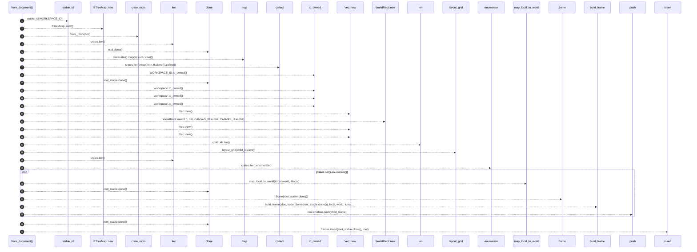
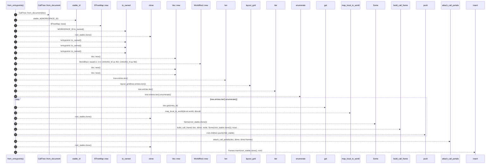
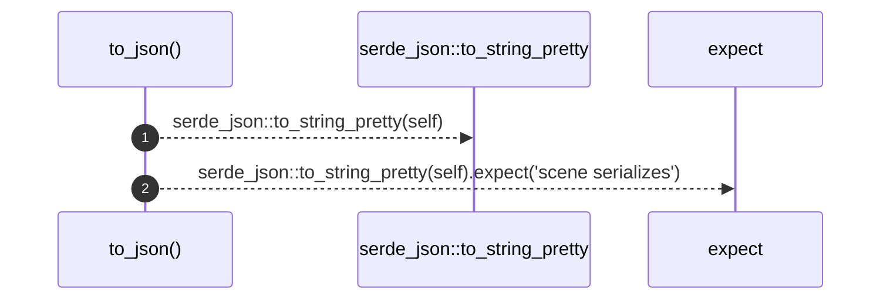

# `robby_render::view::scene::impl Scene`

[Self-model](../../../README.md) · [view::scene](index.md)

| | |
|---|---|
| kind | `code.impl` |
| location | [`crates/robby-render/src/view/scene.rs:116`](../../../../../crates/robby-render/src/view/scene.rs#L116) |
| provenance | extractor · confidence 1.00 |

```rust
impl Scene {
    /// Build the scene from a document. Layout is deterministic integer geometry.
    pub fn from_document(doc: &Document) -> Self {
        let root_stable = stable_id(WORKSPACE_ID);
        let mut frames = BTreeMap::new();

        let crates = crate_roots(doc);
        let child_ids: Vec<NodeId> = crates.iter().map(|n| n.id.clone()).collect();

        let mut root = Frame {
            id: WORKSPACE_ID.to_owned(),
            stable_id: root_stable.clone(),
            name: "workspace".to_owned(),
            fqn: "workspace".to_owned(),
            kind_tag: "workspace".to_owned(),
            parent: None,
            children: Vec::new(),
            world: WorldRect::new(0.0, 0.0, CANVAS_W as f64, CANVAS_H as f64),
            local_in_parent: None,
            edges: Vec::new(),
            portals: Vec::new(),
        };

        let placements = layout_grid(child_ids.len());
        for (i, node) in crates.iter().enumerate() {
            let local = placements[i];
            let world = map_local_to_world(&root.world, &local);
            let child_stable = build_frame(
                doc,
                node,
                Some(root_stable.clone()),
                local,
                world,
                &mut frames,
            );
            root.children.push(child_stable);
        }

        frames.insert(root_stable.clone(), root);

        Scene {
            root: root_stable,
            canvas: CanvasSize {
                w: CANVAS_W,
                h: CANVAS_H,
            },
            frames,
        }
    }

    /// Functional org: workspace → `main` entrypoints → Calls reachability tree.
    pub fn from_entrypoints(doc: &Document) -> Self {
        let tree = CallTree::from_document(doc);
        let root_stable = stable_id(WORKSPACE_ID);
        let mut frames = BTreeMap::new();

        let mut root = Frame {
            id: WORKSPACE_ID.to_owned(),
            stable_id: root_stable.clone(),
            name: "entrypoints".to_owned(),
            fqn: "entrypoints".to_owned(),
            kind_tag: "entrypoints".to_owned(),
            parent: None,
            children: Vec::new(),
            world: WorldRect::new(0.0, 0.0, CANVAS_W as f64, CANVAS_H as f64),
            local_in_parent: None,
            edges: Vec::new(),
            portals: Vec::new(),
        };

        let placements = layout_grid(tree.entries.len());
        for (i, entry_id) in tree.entries.iter().enumerate() {
            let Some(node) = doc.get(entry_id) else {
                continue;
            };
            let local = placements[i];
            let world = map_local_to_world(&root.world, &local);
            let child_stable = build_call_frame(
                doc,
                &tree,
                node,
                Some(root_stable.clone()),
                local,
                world,
                &mut frames,
            );
            root.children.push(child_stable);
        }

        // Portal strip: tree Calls + shared-callee cross edges.
        attach_call_portals(doc, &tree, &mut frames);

        frames.insert(root_stable.clone(), root);

        Scene {
            root: root_stable,
            canvas: CanvasSize {
                w: CANVAS_W,
                h: CANVAS_H,
            },
            frames,
        }
    }

    pub fn to_json(&self) -> String {
        serde_json::to_string_pretty(self).expect("scene serializes")
    }
}
```

## References

- calls → [`robby_ir::model`](../../../robby_ir/model/index.md) — insert
- calls → [`robby_ir::run`](../../../robby_ir/run/index.md) — get
- calls → [`robby_render`](../../index.md) — stable_id
- calls → [`robby_render::report`](../../report/index.md) — push
- calls → [`robby_render::view::scene`](index.md) — 7 items
- calls → [`robby_render::view::select`](../select/index.md) — collect

## Referenced by

- calls ← [`robby_render::test_web::entrypoints_scene_json_is_deterministic`](../../test_web/entrypoints-scene-json-is-deterministic.md)
- calls ← [`robby_render::test_web::entrypoints_scene_roots_mains_and_nests_callees`](../../test_web/entrypoints-scene-roots-mains-and-nests-callees.md)
- calls ← [`robby_render::web::write_site`](../../web/write-site.md)

### `from_document`

| | |
|---|---|
| kind | `code.method` |
| signature | `fn from_document(1)` |
| location | [`crates/robby-render/src/view/scene.rs:117`](../../../../../crates/robby-render/src/view/scene.rs#L117) |
| provenance | extractor · confidence 1.00 |

> Build the scene from a document. Layout is deterministic integer geometry.

```rust
/// Build the scene from a document. Layout is deterministic integer geometry.
    pub fn from_document(doc: &Document) -> Self {
        let root_stable = stable_id(WORKSPACE_ID);
        let mut frames = BTreeMap::new();

        let crates = crate_roots(doc);
        let child_ids: Vec<NodeId> = crates.iter().map(|n| n.id.clone()).collect();

        let mut root = Frame {
            id: WORKSPACE_ID.to_owned(),
            stable_id: root_stable.clone(),
            name: "workspace".to_owned(),
            fqn: "workspace".to_owned(),
            kind_tag: "workspace".to_owned(),
            parent: None,
            children: Vec::new(),
            world: WorldRect::new(0.0, 0.0, CANVAS_W as f64, CANVAS_H as f64),
            local_in_parent: None,
            edges: Vec::new(),
            portals: Vec::new(),
        };

        let placements = layout_grid(child_ids.len());
        for (i, node) in crates.iter().enumerate() {
            let local = placements[i];
            let world = map_local_to_world(&root.world, &local);
            let child_stable = build_frame(
                doc,
                node,
                Some(root_stable.clone()),
                local,
                world,
                &mut frames,
            );
            root.children.push(child_stable);
        }

        frames.insert(root_stable.clone(), root);

        Scene {
            root: root_stable,
            canvas: CanvasSize {
                w: CANVAS_W,
                h: CANVAS_H,
            },
            frames,
        }
    }
```



27 steps · 0 observed · 27 possible only

**Edges**

- calls → [`robby_render::stable_id`](../../stable-id.md)
- calls → [`robby_render::view::scene::impl Rect::new`](index.md)
- calls → [`robby_render::view::scene::crate_roots`](crate-roots.md)
- calls → [`robby_render::view::select::collect`](../select/collect.md)
- calls → [`robby_render::view::scene::impl Rect::new`](index.md)
- calls → [`robby_render::view::scene::impl Rect::new`](index.md)
- calls → [`robby_render::view::scene::impl Rect::new`](index.md)
- calls → [`robby_render::view::scene::impl Rect::new`](index.md)
- calls → [`robby_render::view::scene::layout_grid`](layout-grid.md)
- calls → [`robby_render::view::scene::map_local_to_world`](map-local-to-world.md)
- calls → [`robby_render::view::scene::build_frame`](build-frame.md)
- calls → [`robby_render::report::impl Report::push`](../../report/index.md)
- calls → [`robby_ir::model::impl Document::insert`](../../../robby_ir/model/index.md)

### `from_entrypoints`

| | |
|---|---|
| kind | `code.method` |
| signature | `fn from_entrypoints(1)` |
| location | [`crates/robby-render/src/view/scene.rs:166`](../../../../../crates/robby-render/src/view/scene.rs#L166) |
| provenance | extractor · confidence 1.00 |

> Functional org: workspace → `main` entrypoints → Calls reachability tree.

```rust
/// Functional org: workspace → `main` entrypoints → Calls reachability tree.
    pub fn from_entrypoints(doc: &Document) -> Self {
        let tree = CallTree::from_document(doc);
        let root_stable = stable_id(WORKSPACE_ID);
        let mut frames = BTreeMap::new();

        let mut root = Frame {
            id: WORKSPACE_ID.to_owned(),
            stable_id: root_stable.clone(),
            name: "entrypoints".to_owned(),
            fqn: "entrypoints".to_owned(),
            kind_tag: "entrypoints".to_owned(),
            parent: None,
            children: Vec::new(),
            world: WorldRect::new(0.0, 0.0, CANVAS_W as f64, CANVAS_H as f64),
            local_in_parent: None,
            edges: Vec::new(),
            portals: Vec::new(),
        };

        let placements = layout_grid(tree.entries.len());
        for (i, entry_id) in tree.entries.iter().enumerate() {
            let Some(node) = doc.get(entry_id) else {
                continue;
            };
            let local = placements[i];
            let world = map_local_to_world(&root.world, &local);
            let child_stable = build_call_frame(
                doc,
                &tree,
                node,
                Some(root_stable.clone()),
                local,
                world,
                &mut frames,
            );
            root.children.push(child_stable);
        }

        // Portal strip: tree Calls + shared-callee cross edges.
        attach_call_portals(doc, &tree, &mut frames);

        frames.insert(root_stable.clone(), root);

        Scene {
            root: root_stable,
            canvas: CanvasSize {
                w: CANVAS_W,
                h: CANVAS_H,
            },
            frames,
        }
    }
```



25 steps · 0 observed · 25 possible only

**Edges**

- calls → [`robby_render::view::scene::impl Scene::from_document`](index.md)
- calls → [`robby_render::stable_id`](../../stable-id.md)
- calls → [`robby_render::view::scene::impl Rect::new`](index.md)
- calls → [`robby_render::view::scene::impl Rect::new`](index.md)
- calls → [`robby_render::view::scene::impl Rect::new`](index.md)
- calls → [`robby_render::view::scene::impl Rect::new`](index.md)
- calls → [`robby_render::view::scene::impl Rect::new`](index.md)
- calls → [`robby_render::view::scene::layout_grid`](layout-grid.md)
- calls → [`robby_ir::run::RecipeCatalog::get`](../../../robby_ir/run/index.md)
- calls → [`robby_render::view::scene::map_local_to_world`](map-local-to-world.md)
- calls → [`robby_render::view::scene::build_call_frame`](build-call-frame.md)
- calls → [`robby_render::report::impl Report::push`](../../report/index.md)
- calls → [`robby_render::view::scene::attach_call_portals`](attach-call-portals.md)
- calls → [`robby_ir::model::impl Document::insert`](../../../robby_ir/model/index.md)

### `to_json`

| | |
|---|---|
| kind | `code.method` |
| signature | `fn to_json(1)` |
| location | [`crates/robby-render/src/view/scene.rs:220`](../../../../../crates/robby-render/src/view/scene.rs#L220) |
| provenance | extractor · confidence 1.00 |

```rust
pub fn to_json(&self) -> String {
        serde_json::to_string_pretty(self).expect("scene serializes")
    }
```



2 steps · 0 observed · 2 possible only

