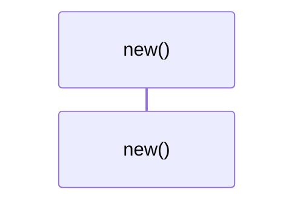
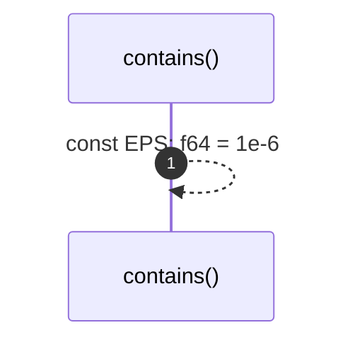

# `robby_render::view::scene::impl WorldRect`

[Self-model](../../../README.md) · [view::scene](index.md)

| | |
|---|---|
| kind | `code.impl` |
| location | [`crates/robby-render/src/view/scene.rs:65`](../../../../../crates/robby-render/src/view/scene.rs#L65) |
| provenance | extractor · confidence 1.00 |

```rust
impl WorldRect {
    pub fn new(x: f64, y: f64, w: f64, h: f64) -> Self {
        Self { x, y, w, h }
    }

    pub fn contains(&self, other: &WorldRect) -> bool {
        const EPS: f64 = 1e-6;
        other.x >= self.x - EPS
            && other.y >= self.y - EPS
            && other.x + other.w <= self.x + self.w + EPS
            && other.y + other.h <= self.y + self.h + EPS
    }
}
```

## Referenced by

- calls ← [`robby_extract::rust::resolve_calls`](../../../robby_extract/rust/resolve-calls.md)
- calls ← [`robby_extract::test_typescript::bare_import_creates_external_npm_stub`](../../../robby_extract/test_typescript/bare-import-creates-external-npm-stub.md)
- calls ← [`robby_extract::test_typescript::resolves_calls_and_imports`](../../../robby_extract/test_typescript/resolves-calls-and-imports.md)
- calls ← [`robby_extract::typescript::resolve_calls`](../../../robby_extract/typescript/resolve-calls.md)
- calls ← [`robby_ir::model::impl Document::declare_file`](../../../robby_ir/model/index.md)
- calls ← [`robby_ir::model::impl Document::insert`](../../../robby_ir/model/index.md)
- calls ← [`robby_ir::model::impl Document::merge`](../../../robby_ir/model/index.md)
- calls ← [`robby_render::test_tree::every_internal_link_resolves`](../../test_tree/every-internal-link-resolves.md)
- calls ← [`robby_render::test_web::entrypoints_scene_roots_mains_and_nests_callees`](../../test_web/entrypoints-scene-roots-mains-and-nests-callees.md)
- calls ← [`robby_render::view::comments::impl CommentsView::from_root`](../comments/index.md)
- calls ← [`robby_render::view::deps::finalize_edges`](../deps/finalize-edges.md)
- calls ← [`robby_render::view::deps::impl CouplingGraph::workspace`](../deps/index.md)
- calls ← [`robby_render::view::deps::is_direct_package`](../deps/is-direct-package.md)
- calls ← [`robby_render::view::deps::lift_to_scope`](../deps/lift-to-scope.md)
- calls ← [`robby_render::view::deps::owning_in_scope`](../deps/owning-in-scope.md)
- calls ← [`robby_render::view::deps::package_edges`](../deps/package-edges.md)
- calls ← [`robby_render::view::deps::topological_layers`](../deps/topological-layers.md)
- calls ← [`robby_render::view::entrypoints::collect_cross_edges`](../entrypoints/collect-cross-edges.md)
- calls ← [`robby_render::view::entrypoints::impl CallTree::from_code_paths`](../entrypoints/index.md)
- calls ← [`robby_render::view::execution::owning_type_label`](../execution/owning-type-label.md)
- calls ← [`robby_render::view::links::inbound`](../links/inbound.md)
- calls ← [`robby_render::view::links::outbound`](../links/outbound.md)
- calls ← [`robby_render::view::scene::build_call_frame`](build-call-frame.md)
- calls ← [`robby_render::view::scene::portals_for`](portals-for.md)
- calls ← [`robby_render::view::sibling::impl SiblingGraph::from_root`](../sibling/index.md)

### `new`

| | |
|---|---|
| kind | `code.method` |
| signature | `fn new(4)` |
| location | [`crates/robby-render/src/view/scene.rs:66`](../../../../../crates/robby-render/src/view/scene.rs#L66) |
| provenance | extractor · confidence 1.00 |

```rust
pub fn new(x: f64, y: f64, w: f64, h: f64) -> Self {
        Self { x, y, w, h }
    }
```



0 steps · 0 observed · 0 possible only

### `contains`

| | |
|---|---|
| kind | `code.method` |
| signature | `fn contains(2)` |
| location | [`crates/robby-render/src/view/scene.rs:70`](../../../../../crates/robby-render/src/view/scene.rs#L70) |
| provenance | extractor · confidence 1.00 |

```rust
pub fn contains(&self, other: &WorldRect) -> bool {
        const EPS: f64 = 1e-6;
        other.x >= self.x - EPS
            && other.y >= self.y - EPS
            && other.x + other.w <= self.x + self.w + EPS
            && other.y + other.h <= self.y + self.h + EPS
    }
```



1 steps · 0 observed · 1 possible only

