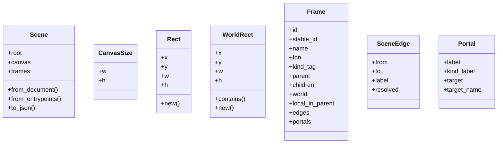
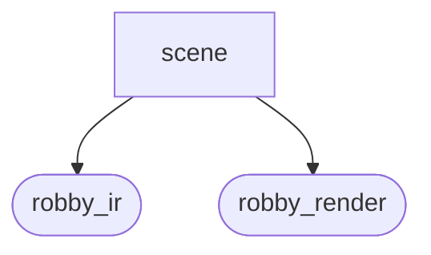
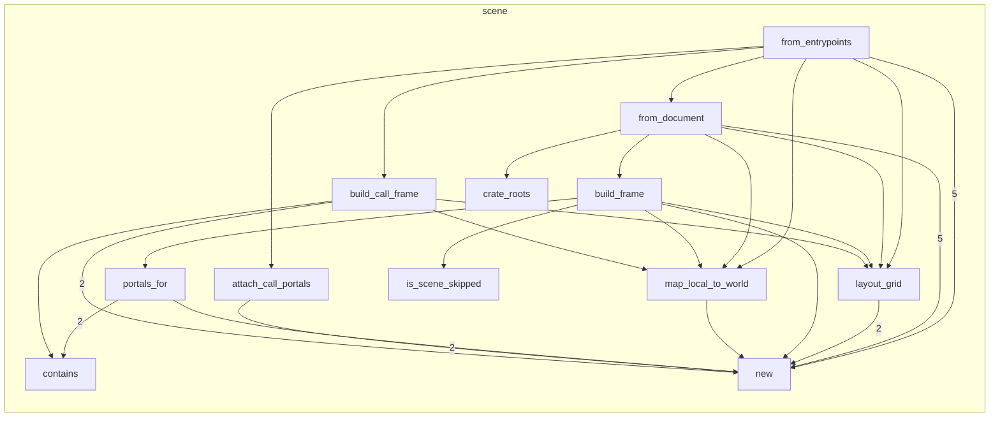

# `robby_render::view::scene`

[Self-model](../../../README.md) · [view](../index.md)

| | |
|---|---|
| kind | `code.module` |
| declared at | [`crates/robby-render/src/view/mod.rs:14`](../../../../../crates/robby-render/src/view/mod.rs#L14) |
| provenance | extractor · confidence 1.00 |
| nodes | 71 |

## Types



## Package diagram



## Module coupling



## Dependency matrix

| | scene | robby_ir | robby_render |
|---|---:|---:|---:|
| **scene** | · | 15 | 69 |
| **robby_ir** | | · | |
| **robby_render** | | | · |

## Comments

- `crates/robby-render/src/view/scene.rs:117:5` (docs, `robby_render::view::scene::impl Scene::from_document`): "Build the scene from a document. Layout is deterministic integer geometry."
  ```
  /// Build the scene from a document. Layout is deterministic integer geometry.
      pub fn from_document(doc: &Document) -> Self {
          let root_stable = stable_id(WORKSPACE_ID);
          let mut frames = BTreeMap::new();
  
          let crates = crate_roots(doc);
          let child_ids: Vec<NodeId> = crates.iter().map(|n| n.id.clone()).collect();
  
          let mut root = Frame {
              id: WORKSPACE_ID.to_owned(),
              stable_id: root_stable.clone(),
              name: "workspace".to_owned(),
              fqn: "workspace".to_owned(),
              kind_tag: "workspace".to_owned(),
              parent: None,
              children: Vec::new(),
              world: WorldRect::new(0.0, 0.0, CANVAS_W as f64, CANVAS_H as f64),
              local_in_parent: None,
              edges: Vec::new(),
              portals: Vec::new(),
          };
  
          let placements = layout_grid(child_ids.len());
          for (i, node) in crates.iter().enumerate() {
              let local = placements[i];
              let world = map_local_to_world(&root.world, &local);
              let child_stable = build_frame(
                  doc,
                  node,
                  Some(root_stable.clone()),
                  local,
                  world,
                  &mut frames,
              );
              root.children.push(child_stable);
          }
  
          frames.insert(root_stable.clone(), root);
  
          Scene {
              root: root_stable,
              canvas: CanvasSize {
                  w: CANVAS_W,
                  h: CANVAS_H,
              },
              frames,
          }
      }
  ```
- `crates/robby-render/src/view/scene.rs:166:5` (docs, `robby_render::view::scene::impl Scene::from_entrypoints`): "Functional org: workspace → `main` entrypoints → Calls reachability tree."
  ```
  /// Functional org: workspace → `main` entrypoints → Calls reachability tree.
      pub fn from_entrypoints(doc: &Document) -> Self {
          let tree = CallTree::from_document(doc);
          let root_stable = stable_id(WORKSPACE_ID);
          let mut frames = BTreeMap::new();
  
          let mut root = Frame {
              id: WORKSPACE_ID.to_owned(),
              stable_id: root_stable.clone(),
              name: "entrypoints".to_owned(),
              fqn: "entrypoints".to_owned(),
              kind_tag: "entrypoints".to_owned(),
              parent: None,
              children: Vec::new(),
              world: WorldRect::new(0.0, 0.0, CANVAS_W as f64, CANVAS_H as f64),
              local_in_parent: None,
              edges: Vec::new(),
              portals: Vec::new(),
          };
  
          let placements = layout_grid(tree.entries.len());
          for (i, entry_id) in tree.entries.iter().enumerate() {
              let Some(node) = doc.get(entry_id) else {
                  continue;
              };
              let local = placements[i];
              let world = map_local_to_world(&root.world, &local);
              let child_stable = build_call_frame(
                  doc,
                  &tree,
                  node,
                  Some(root_stable.clone()),
                  local,
                  world,
                  &mut frames,
              );
              root.children.push(child_stable);
          }
  
          // Portal strip: tree Calls + shared-callee cross edges.
          attach_call_portals(doc, &tree, &mut frames);
  
          frames.insert(root_stable.clone(), root);
  
          Scene {
              root: root_stable,
              canvas: CanvasSize {
                  w: CANVAS_W,
                  h: CANVAS_H,
              },
              frames,
          }
      }
  ```
- `crates/robby-render/src/view/scene.rs:26:1` (docs, `robby_render::view::scene::Scene`): "Whole zoomable map: one frame per structural node, plus a synthetic workspace."
  ```
  /// Whole zoomable map: one frame per structural node, plus a synthetic workspace.
  #[derive(Debug, Clone, PartialEq, Serialize)]
  pub struct Scene {
      pub root: String,
      pub canvas: CanvasSize,
      pub frames: BTreeMap<String, Frame>,
  }
  ```
- `crates/robby-render/src/view/scene.rs:377:1` (docs, `robby_render::view::scene::attach_call_portals`): "Portals for every Calls hop among placed frames (tree children + cross edges)."
  ```
  /// Portals for every Calls hop among placed frames (tree children + cross edges).
  fn attach_call_portals(
      doc: &Document,
      tree: &CallTree,
      frames: &mut BTreeMap<String, Frame>,
  ) {
      let mut pairs: Vec<(NodeId, NodeId)> = Vec::new();
      for (from_id, kids) in &tree.children {
          for to_id in kids {
              pairs.push((from_id.clone(), to_id.clone()));
          }
      }
      pairs.extend(tree.cross_edges.iter().cloned());
      pairs.sort_by(|a, b| {
          a.0.as_str()
              .cmp(b.0.as_str())
              .then_with(|| a.1.as_str().cmp(b.1.as_str()))
      });
      pairs.dedup();
  
      for (from_id, to_id) in &pairs {
          let from_sid = stable_id(from_id.as_str());
          let to_sid = stable_id(to_id.as_str());
          if !frames.contains_key(&from_sid) || !frames.contains_key(&to_sid) {
              continue;
          }
          let to_name = doc
              .get(to_id)
              .map(|n| n.fqn.clone())
              .unwrap_or_else(|| to_id.as_str().to_owned());
          let from_name = doc
              .get(from_id)
              .map(|n| n.fqn.clone())
              .unwrap_or_else(|| from_id.as_str().to_owned());
  
          if let Some(from_frame) = frames.get_mut(&from_sid) {
              from_frame.portals.push(Portal {
                  label: to_name.clone(),
                  kind_label: "calls".to_owned(),
                  target: Some(to_sid.clone()),
                  target_name: to_name,
              });
          }
          if let Some(to_frame) = frames.get_mut(&to_sid) {
              to_frame.portals.push(Portal {
                  label: format!("from {from_name}"),
                  kind_label: "called".to_owned(),
                  target: Some(from_sid),
                  target_name: from_name,
              });
          }
      }
  
      for frame in frames.values_mut() {
          frame.portals.sort_by(|a, b| {
              (
                  a.kind_label.as_str(),
                  a.target_name.as_str(),
                  a.label.as_str(),
              )
                  .cmp(&(
                      b.kind_label.as_str(),
                      b.target_name.as_str(),
                      b.label.as_str(),
                  ))
          });
          frame.portals.dedup_by(|a, b| {
              a.label == b.label && a.kind_label == b.kind_label && a.target == b.target
          });
      }
  }
  ```
- `crates/robby-render/src/view/scene.rs:40:1` (docs, `robby_render::view::scene::Rect`): "Integer rect on a frame's local 1600×1000 canvas."
  ```
  /// Integer rect on a frame's local 1600×1000 canvas.
  #[derive(Debug, Clone, Copy, PartialEq, Eq, Serialize)]
  pub struct Rect {
      pub x: i64,
      pub y: i64,
      pub w: i64,
      pub h: i64,
  }
  ```
- `crates/robby-render/src/view/scene.rs:522:1` (docs, `robby_render::view::scene::layout_grid`): "Place `n` children in a grid on the local canvas (below the header, above portals)."
  ```
  /// Place `n` children in a grid on the local canvas (below the header, above portals).
  fn layout_grid(n: usize) -> Vec<Rect> {
      if n == 0 {
          return Vec::new();
      }
      let cols = (n as f64).sqrt().ceil() as usize;
      let cols = cols.max(1);
      let rows = n.div_ceil(cols);
  
      let available_w = CANVAS_W - 2 * PAD;
      let available_h = CANVAS_H - HEADER - PORTAL_STRIP - PAD;
      let cell_w = available_w / cols as i64;
      let cell_h = available_h / rows as i64;
  
      let mut out = Vec::with_capacity(n);
      for i in 0..n {
          let col = (i % cols) as i64;
          let row = (i / cols) as i64;
          let fit_w = cell_w - 2 * CELL_MARGIN;
          let fit_h = cell_h - 2 * CELL_MARGIN;
          let scale_num = fit_w.min(fit_h);
          let scale_den = CANVAS_W.max(CANVAS_H);
          // Fit the child canvas into the cell, preserving aspect ratio.
          let child_w = (CANVAS_W * scale_num) / scale_den;
          let child_h = (CANVAS_H * scale_num) / scale_den;
          let x = PAD + col * cell_w + (cell_w - child_w) / 2;
          let y = HEADER + row * cell_h + (cell_h - child_h) / 2;
          out.push(Rect::new(x, y, child_w.max(1), child_h.max(1)));
      }
      out
  }
  ```
- `crates/robby-render/src/view/scene.rs:554:1` (docs, `robby_render::view::scene::is_scene_skipped`): "Comments stay in the IR and markdown tree, but are not Prezi frames."
  ```
  /// Comments stay in the IR and markdown tree, but are not Prezi frames.
  fn is_scene_skipped(kind_name: &str) -> bool {
      kind_name == kind::code::COMMENT
  }
  ```
- `crates/robby-render/src/view/scene.rs:55:1` (docs, `robby_render::view::scene::WorldRect`): "Absolute placement in workspace space. Floats so nested grids do not collapse to 1×1 integer cells and stack on top of …"
  ```
  /// Absolute placement in workspace space. Floats so nested grids do not
  /// collapse to 1×1 integer cells and stack on top of each other.
  #[derive(Debug, Clone, Copy, PartialEq, Serialize)]
  pub struct WorldRect {
      pub x: f64,
      pub y: f64,
      pub w: f64,
      pub h: f64,
  }
  ```
## References

- calls → [`robby_ir::model`](../../../robby_ir/model/index.md) — get, insert, subtree
- calls → [`robby_render`](../../index.md) — stable_id
- calls → [`robby_render::report`](../../report/index.md) — push
- calls → [`robby_render::util`](../../util/index.md) — edge_label, is_structural, short_kind
- calls → [`robby_render::view::comments`](../comments/index.md) — as_str
- calls → [`robby_render::view::deps`](../deps/index.md) — from_root
- calls → [`robby_render::view::entrypoints`](../entrypoints/index.md) — children_of
- calls → [`robby_render::view::links`](../links/index.md) — for_node, is_empty
- calls → [`robby_render::view::select`](../select/index.md) — collect

## Referenced by

- calls ← [`robby_extract::rust::resolve_calls`](../../../robby_extract/rust/resolve-calls.md)
- calls ← [`robby_extract::test_typescript::bare_import_creates_external_npm_stub`](../../../robby_extract/test_typescript/bare-import-creates-external-npm-stub.md)
- calls ← [`robby_extract::test_typescript::resolves_calls_and_imports`](../../../robby_extract/test_typescript/resolves-calls-and-imports.md)
- calls ← [`robby_extract::typescript::resolve_calls`](../../../robby_extract/typescript/resolve-calls.md)
- calls ← [`robby_ir::model::impl Document::declare_file`](../../../robby_ir/model/index.md)
- calls ← [`robby_ir::model::impl Document::insert`](../../../robby_ir/model/index.md)
- calls ← [`robby_ir::model::impl Document::merge`](../../../robby_ir/model/index.md)
- calls ← [`robby_render::test_tree::every_internal_link_resolves`](../../test_tree/every-internal-link-resolves.md)
- calls ← [`robby_render::test_web::entrypoints_scene_json_is_deterministic`](../../test_web/entrypoints-scene-json-is-deterministic.md)
- calls ← [`robby_render::test_web::entrypoints_scene_roots_mains_and_nests_callees`](../../test_web/entrypoints-scene-roots-mains-and-nests-callees.md)
- calls ← [`robby_render::view::comments::apply_highlights`](../comments/apply-highlights.md)
- calls ← [`robby_render::view::comments::impl CommentsView::from_root`](../comments/index.md)
- calls ← [`robby_render::view::comments::line_window`](../comments/line-window.md)
- calls ← [`robby_render::view::deps::finalize_edges`](../deps/finalize-edges.md)
- calls ← [`robby_render::view::deps::impl CouplingGraph::empty`](../deps/index.md)
- calls ← [`robby_render::view::deps::impl CouplingGraph::from_root`](../deps/index.md)
- calls ← [`robby_render::view::deps::impl CouplingGraph::workspace`](../deps/index.md)
- calls ← [`robby_render::view::deps::impl PackageStructure::empty`](../deps/index.md)
- calls ← [`robby_render::view::deps::is_direct_package`](../deps/is-direct-package.md)
- calls ← [`robby_render::view::deps::lift_to_scope`](../deps/lift-to-scope.md)
- calls ← [`robby_render::view::deps::owning_in_scope`](../deps/owning-in-scope.md)
- calls ← [`robby_render::view::deps::package_edges`](../deps/package-edges.md)
- calls ← [`robby_render::view::deps::package_leaf`](../deps/package-leaf.md)
- calls ← [`robby_render::view::deps::tarjan`](../deps/tarjan.md)
- calls ← [`robby_render::view::deps::topological_layers`](../deps/topological-layers.md)
- calls ← [`robby_render::view::entrypoints::collect_cross_edges`](../entrypoints/collect-cross-edges.md)
- calls ← [`robby_render::view::entrypoints::doc_with_mains`](../entrypoints/tests/doc-with-mains.md)
- calls ← [`robby_render::view::entrypoints::impl CallTree::from_code_paths`](../entrypoints/index.md)
- calls ← [`robby_render::view::execution::from_code_path`](../execution/from-code-path.md)
- calls ← [`robby_render::view::execution::owning_type_label`](../execution/owning-type-label.md)
- calls ← [`robby_render::view::execution::sample`](../execution/tests/sample.md)
- calls ← [`robby_render::view::externals::impl ExternalsView::from_root`](../externals/index.md)
- calls ← [`robby_render::view::hierarchy::build`](../hierarchy/build.md)
- calls ← [`robby_render::view::links::inbound`](../links/inbound.md)
- calls ← [`robby_render::view::links::outbound`](../links/outbound.md)
- calls ← [`robby_render::view::process::impl ProcessView::from_process`](../process/index.md)
- calls ← [`robby_render::view::sibling::impl SiblingGraph::from_root`](../sibling/index.md)
- calls ← [`robby_render::view::types::class_from_node`](../types/class-from-node.md)
- calls ← [`robby_render::view::types::impl TypeModel::from_module`](../types/index.md)
- calls ← [`robby_render::web::write_site`](../../web/write-site.md)

## Items

| Item | Kind | Steps | Location |
|---|---|---:|---|
| [`CANVAS_W`](canvas-w.md) | `code.const` | — | `crates/robby-render/src/view/scene.rs:14:1` |
| [`CANVAS_H`](canvas-h.md) | `code.const` | — | `crates/robby-render/src/view/scene.rs:16:1` |
| [`PAD`](pad.md) | `code.const` | — | `crates/robby-render/src/view/scene.rs:18:1` |
| [`HEADER`](header.md) | `code.const` | — | `crates/robby-render/src/view/scene.rs:19:1` |
| [`PORTAL_STRIP`](portal-strip.md) | `code.const` | — | `crates/robby-render/src/view/scene.rs:20:1` |
| [`CELL_MARGIN`](cell-margin.md) | `code.const` | — | `crates/robby-render/src/view/scene.rs:21:1` |
| [`WORKSPACE_ID`](workspace-id.md) | `code.const` | — | `crates/robby-render/src/view/scene.rs:23:1` |
| [`Scene`](scene.md) | `code.struct` | — | `crates/robby-render/src/view/scene.rs:26:1` |
| [`CanvasSize`](canvassize.md) | `code.struct` | — | `crates/robby-render/src/view/scene.rs:34:1` |
| [`Rect`](rect.md) | `code.struct` | — | `crates/robby-render/src/view/scene.rs:40:1` |
| [`impl Rect`](impl-rect.md) | `code.impl` | — | `crates/robby-render/src/view/scene.rs:49:1` |
| [`WorldRect`](worldrect.md) | `code.struct` | — | `crates/robby-render/src/view/scene.rs:55:1` |
| [`impl WorldRect`](impl-worldrect.md) | `code.impl` | — | `crates/robby-render/src/view/scene.rs:65:1` |
| [`Frame`](frame.md) | `code.struct` | — | `crates/robby-render/src/view/scene.rs:79:1` |
| [`SceneEdge`](sceneedge.md) | `code.struct` | — | `crates/robby-render/src/view/scene.rs:98:1` |
| [`Portal`](portal.md) | `code.struct` | — | `crates/robby-render/src/view/scene.rs:106:1` |
| [`impl Scene`](impl-scene.md) | `code.impl` | — | `crates/robby-render/src/view/scene.rs:116:1` |
| [`crate_roots`](crate-roots.md) | `code.function` | 14 | `crates/robby-render/src/view/scene.rs:225:1` |
| [`build_frame`](build-frame.md) | `code.function` | 38 | `crates/robby-render/src/view/scene.rs:248:1` |
| [`build_call_frame`](build-call-frame.md) | `code.function` | 44 | `crates/robby-render/src/view/scene.rs:312:1` |
| [`attach_call_portals`](attach-call-portals.md) | `code.function` | 55 | `crates/robby-render/src/view/scene.rs:377:1` |
| [`portals_for`](portals-for.md) | `code.function` | 49 | `crates/robby-render/src/view/scene.rs:449:1` |
| [`layout_grid`](layout-grid.md) | `code.function` | 13 | `crates/robby-render/src/view/scene.rs:522:1` |
| [`is_scene_skipped`](is-scene-skipped.md) | `code.function` | 0 | `crates/robby-render/src/view/scene.rs:554:1` |
| [`map_local_to_world`](map-local-to-world.md) | `code.function` | 1 | `crates/robby-render/src/view/scene.rs:559:1` |

## Imports

- `use std::collections::{BTreeMap, BTreeSet};`
- `use serde::Serialize;`
- [`use robby_ir::{Document, Node, NodeId, kind};`](../../../robby_ir/index.md)
- `use crate::util::{edge_label, is_structural, short_kind, stable_id};`
- `use crate::view::entrypoints::CallTree;`
- `use crate::view::links::LinkGraph;`
- `use crate::view::sibling::SiblingGraph;`

