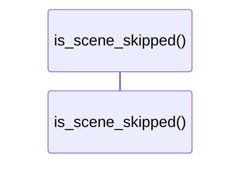

# `robby_render::view::scene::is_scene_skipped`

[Self-model](../../../README.md) · [view::scene](index.md)

| | |
|---|---|
| kind | `code.function` |
| signature | `fn is_scene_skipped(kind_name: &str) -> bool` |
| location | [`crates/robby-render/src/view/scene.rs:539`](../../../../../crates/robby-render/src/view/scene.rs#L539) |
| provenance | extractor · confidence 1.00 |

> Comments stay in the IR and markdown tree, but are not Prezi frames.

```rust
/// Comments stay in the IR and markdown tree, but are not Prezi frames.
fn is_scene_skipped(kind_name: &str) -> bool {
    kind_name == kind::code::COMMENT
}
```



0 steps · 0 observed · 0 possible only

## Referenced by

- calls ← [`robby_render::view::scene::build_frame`](build-frame.md)

