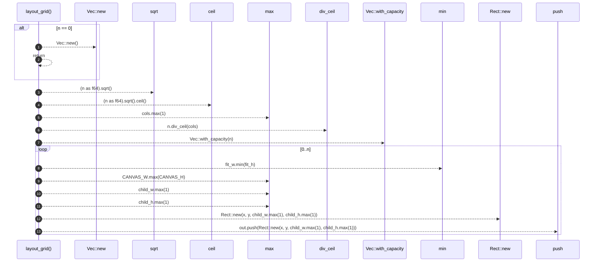

# `robby_render::view::scene::layout_grid`

[Self-model](../../../README.md) · [view::scene](index.md)

| | |
|---|---|
| kind | `code.function` |
| signature | `fn layout_grid(n: usize) -> Vec<Rect>` |
| location | [`crates/robby-render/src/view/scene.rs:507`](../../../../../crates/robby-render/src/view/scene.rs#L507) |
| provenance | extractor · confidence 1.00 |

> Place `n` children in a grid on the local canvas (below the header, above portals).

```rust
/// Place `n` children in a grid on the local canvas (below the header, above portals).
fn layout_grid(n: usize) -> Vec<Rect> {
    if n == 0 {
        return Vec::new();
    }
    let cols = (n as f64).sqrt().ceil() as usize;
    let cols = cols.max(1);
    let rows = n.div_ceil(cols);

    let available_w = CANVAS_W - 2 * PAD;
    let available_h = CANVAS_H - HEADER - PORTAL_STRIP - PAD;
    let cell_w = available_w / cols as i64;
    let cell_h = available_h / rows as i64;

    let mut out = Vec::with_capacity(n);
    for i in 0..n {
        let col = (i % cols) as i64;
        let row = (i / cols) as i64;
        let fit_w = cell_w - 2 * CELL_MARGIN;
        let fit_h = cell_h - 2 * CELL_MARGIN;
        let scale_num = fit_w.min(fit_h);
        let scale_den = CANVAS_W.max(CANVAS_H);
        // Fit the child canvas into the cell, preserving aspect ratio.
        let child_w = (CANVAS_W * scale_num) / scale_den;
        let child_h = (CANVAS_H * scale_num) / scale_den;
        let x = PAD + col * cell_w + (cell_w - child_w) / 2;
        let y = HEADER + row * cell_h + (cell_h - child_h) / 2;
        out.push(Rect::new(x, y, child_w.max(1), child_h.max(1)));
    }
    out
}
```



13 steps · 0 observed · 13 possible only

**Edges**

- calls → [`robby_render::view::scene::impl Rect::new`](index.md)
- calls → [`robby_render::view::scene::impl Rect::new`](index.md)
- calls → [`robby_render::report::impl Report::push`](../../report/index.md)

## References

- calls → [`robby_render::report`](../../report/index.md) — push
- calls → [`robby_render::view::scene`](index.md) — new

## Referenced by

- calls ← [`robby_render::view::scene::build_call_frame`](build-call-frame.md)
- calls ← [`robby_render::view::scene::build_frame`](build-frame.md)
- calls ← [`robby_render::view::scene::impl Scene::from_document`](index.md)
- calls ← [`robby_render::view::scene::impl Scene::from_entrypoints`](index.md)

