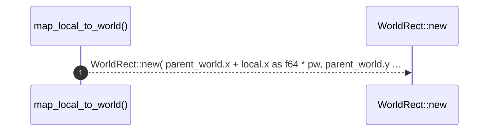

# `robby_render::view::scene::map_local_to_world`

[Self-model](../../../README.md) · [view::scene](index.md)

| | |
|---|---|
| kind | `code.function` |
| signature | `fn map_local_to_world(parent_world: &WorldRect, local: &Rect) -> WorldRect` |
| location | [`crates/robby-render/src/view/scene.rs:559`](../../../../../crates/robby-render/src/view/scene.rs#L559) |
| provenance | extractor · confidence 1.00 |

```rust
fn map_local_to_world(parent_world: &WorldRect, local: &Rect) -> WorldRect {
    let pw = parent_world.w / CANVAS_W as f64;
    let ph = parent_world.h / CANVAS_H as f64;
    WorldRect::new(
        parent_world.x + local.x as f64 * pw,
        parent_world.y + local.y as f64 * ph,
        local.w as f64 * pw,
        local.h as f64 * ph,
    )
}
```



1 steps · 0 observed · 1 possible only

**Edges**

- calls → [`robby_render::view::scene::impl Rect::new`](index.md)

## References

- calls → [`robby_render::view::scene`](index.md) — new

## Referenced by

- calls ← [`robby_render::view::scene::build_call_frame`](build-call-frame.md)
- calls ← [`robby_render::view::scene::build_frame`](build-frame.md)
- calls ← [`robby_render::view::scene::impl Scene::from_document`](index.md)
- calls ← [`robby_render::view::scene::impl Scene::from_entrypoints`](index.md)

