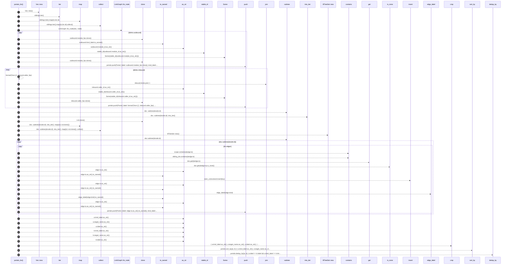

# `robby_render::view::scene::portals_for`

[Self-model](../../../README.md) · [view::scene](index.md)

| | |
|---|---|
| kind | `code.function` |
| signature | `fn portals_for(doc: &Document, node: &Node, siblings: &[&Node]) -> Vec<Portal>` |
| location | [`crates/robby-render/src/view/scene.rs:449`](../../../../../crates/robby-render/src/view/scene.rs#L449) |
| provenance | extractor · confidence 1.00 |

```rust
fn portals_for(doc: &Document, node: &Node, siblings: &[&Node]) -> Vec<Portal> {
    let mut portals = Vec::new();
    let sibling_ids: BTreeSet<&NodeId> = siblings.iter().map(|n| &n.id).collect();

    let links = LinkGraph::for_node(doc, node);
    for outbound in &links.outbound {
        portals.push(Portal {
            label: outbound.module_fqn.clone(),
            kind_label: outbound.kind_label.to_owned(),
            target: Some(stable_id(outbound.module_id.as_str())),
            target_name: outbound.module_fqn.clone(),
        });
    }
    for inbound in &links.inbound {
        portals.push(Portal {
            label: format!("from {}", inbound.caller_fqn),
            kind_label: inbound.kinds.join(","),
            target: Some(stable_id(inbound.caller_id.as_str())),
            target_name: inbound.caller_fqn.clone(),
        });
    }

    // Unresolved edges leaving this frame: visible, no zoom target.
    let scope: BTreeSet<NodeId> = doc
        .subtree(&node.id)
        .into_iter()
        .map(|n| n.id.clone())
        .collect();

    let mut seen_unresolved = BTreeSet::new();
    for n in doc.subtree(&node.id) {
        for edge in &n.edges {
            if scope.contains(&edge.to) {
                continue;
            }
            if sibling_ids.contains(&edge.to) {
                continue;
            }
            let missing = doc.get(&edge.to).is_none();
            if edge.resolved && !missing {
                continue;
            }
            let key = (edge.to.as_str().to_owned(), edge.kind);
            if !seen_unresolved.insert(key) {
                continue;
            }
            portals.push(Portal {
                label: edge.to.as_str().to_owned(),
                kind_label: edge_label(edge.kind).to_owned(),
                target: None,
                target_name: edge.to.as_str().to_owned(),
            });
        }
    }

    portals.sort_by(|a, b| {
        (
            a.kind_label.as_str(),
            a.target_name.as_str(),
            a.label.as_str(),
        )
            .cmp(&(
                b.kind_label.as_str(),
                b.target_name.as_str(),
                b.label.as_str(),
            ))
    });
    portals.dedup_by(|a, b| {
        a.label == b.label && a.kind_label == b.kind_label && a.target == b.target
    });
    portals
}
```



49 steps · 0 observed · 49 possible only

**Edges**

- calls → [`robby_render::view::scene::impl Rect::new`](index.md)
- calls → [`robby_render::view::select::collect`](../select/collect.md)
- calls → [`robby_render::view::links::impl LinkGraph::for_node`](../links/index.md)
- calls → [`robby_render::view::comments::impl NoteKind::as_str`](../comments/index.md)
- calls → [`robby_render::stable_id`](../../stable-id.md)
- calls → [`robby_render::report::impl Report::push`](../../report/index.md)
- calls → [`robby_render::view::comments::impl NoteKind::as_str`](../comments/index.md)
- calls → [`robby_render::stable_id`](../../stable-id.md)
- calls → [`robby_render::report::impl Report::push`](../../report/index.md)
- calls → [`robby_ir::model::impl Document::subtree`](../../../robby_ir/model/index.md)
- calls → [`robby_render::view::select::collect`](../select/collect.md)
- calls → [`robby_render::view::scene::impl Rect::new`](index.md)
- calls → [`robby_ir::model::impl Document::subtree`](../../../robby_ir/model/index.md)
- calls → [`robby_render::view::scene::impl WorldRect::contains`](index.md)
- calls → [`robby_render::view::scene::impl WorldRect::contains`](index.md)
- calls → [`robby_ir::model::impl Document::get`](../../../robby_ir/model/index.md)
- calls → [`robby_render::view::comments::impl NoteKind::as_str`](../comments/index.md)
- calls → [`robby_ir::model::impl Document::insert`](../../../robby_ir/model/index.md)
- calls → [`robby_render::view::comments::impl NoteKind::as_str`](../comments/index.md)
- calls → [`robby_render::util::edge_label`](../../util/edge-label.md)
- calls → [`robby_render::view::comments::impl NoteKind::as_str`](../comments/index.md)
- calls → [`robby_render::report::impl Report::push`](../../report/index.md)
- calls → [`robby_render::view::comments::impl NoteKind::as_str`](../comments/index.md)
- calls → [`robby_render::view::comments::impl NoteKind::as_str`](../comments/index.md)
- calls → [`robby_render::view::comments::impl NoteKind::as_str`](../comments/index.md)
- calls → [`robby_render::view::comments::impl NoteKind::as_str`](../comments/index.md)
- calls → [`robby_render::view::comments::impl NoteKind::as_str`](../comments/index.md)
- calls → [`robby_render::view::comments::impl NoteKind::as_str`](../comments/index.md)

## References

- calls → [`robby_ir::model`](../../../robby_ir/model/index.md) — get, insert, subtree
- calls → [`robby_render`](../../index.md) — stable_id
- calls → [`robby_render::report`](../../report/index.md) — push
- calls → [`robby_render::util`](../../util/index.md) — edge_label
- calls → [`robby_render::view::comments`](../comments/index.md) — as_str
- calls → [`robby_render::view::links`](../links/index.md) — for_node
- calls → [`robby_render::view::scene`](index.md) — contains, new
- calls → [`robby_render::view::select`](../select/index.md) — collect

## Referenced by

- calls ← [`robby_render::view::scene::build_frame`](build-frame.md)

