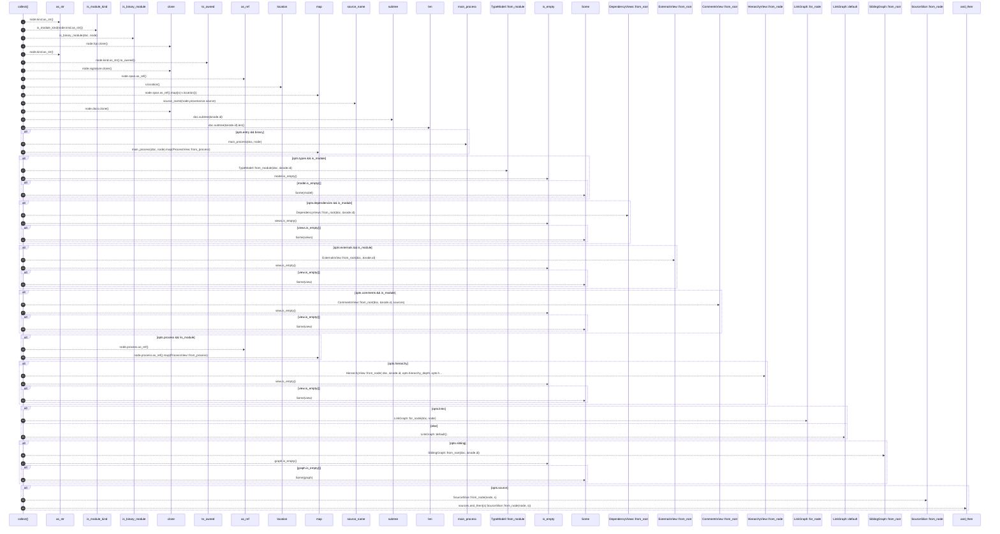

# `robby_render::view::select::collect`

[Self-model](../../../README.md) · [view::select](index.md)

| | |
|---|---|
| kind | `code.function` |
| signature | `fn collect(     doc: &Document,     node: &Node,     sources: Option<&BTreeMap<String, String>>,     opts: &SelectOpts, ) -> NodeViews` |
| location | [`crates/robby-render/src/view/select.rs:97`](../../../../../crates/robby-render/src/view/select.rs#L97) |
| provenance | extractor · confidence 1.00 |

> Project IR → views for one node.

```rust
/// Project IR → views for one node.
pub fn collect(
    doc: &Document,
    node: &Node,
    sources: Option<&BTreeMap<String, String>>,
    opts: &SelectOpts,
) -> NodeViews {
    let is_module = is_module_kind(node.kind.as_str());
    let binary = is_module && is_binary_module(doc, node);

    let meta = NodeMeta {
        fqn: node.fqn.clone(),
        kind: node.kind.as_str().to_owned(),
        signature: node.signature.clone(),
        location: node.span.as_ref().map(|s| s.location()),
        provenance_source: source_name(node.provenance.source),
        confidence: node.provenance.confidence,
        docs: node.docs.clone(),
        node_count: doc.subtree(&node.id).len(),
    };

    let entry = if opts.entry && binary {
        main_process(doc, node).map(ProcessView::from_process)
    } else {
        None
    };

    let types = if opts.types && is_module {
        let model = TypeModel::from_module(doc, &node.id);
        if model.is_empty() {
            None
        } else {
            Some(model)
        }
    } else {
        None
    };

    let dependencies = if opts.dependencies && is_module {
        let views = DependencyViews::from_root(doc, &node.id);
        if views.is_empty() {
            None
        } else {
            Some(views)
        }
    } else {
        None
    };

    let externals = if opts.externals && is_module {
        let view = ExternalsView::from_root(doc, &node.id);
        if view.is_empty() {
            None
        } else {
            Some(view)
        }
    } else {
        None
    };

    let comments = if opts.comments && is_module {
        let view = CommentsView::from_root(doc, &node.id, sources);
        if view.is_empty() {
            None
        } else {
            Some(view)
        }
    } else {
        None
    };

    let process = if opts.process && !is_module {
        node.process.as_ref().map(ProcessView::from_process)
    } else {
        None
    };

    let hierarchy = if opts.hierarchy {
        let view = HierarchyView::from_node(
            doc,
            &node.id,
            opts.hierarchy_depth,
            opts.hierarchy_all,
        );
        if view.is_empty() {
            None
        } else {
            Some(view)
        }
    } else {
        None
    };

    let links = if opts.links {
        LinkGraph::for_node(doc, node)
    } else {
        LinkGraph::default()
    };

    let sibling = if opts.sibling {
        let graph = SiblingGraph::from_root(doc, &node.id);
        if graph.is_empty() {
            None
        } else {
            Some(graph)
        }
    } else {
        None
    };

    let source = if opts.source {
        sources.and_then(|s| SourceSlice::from_node(node, s))
    } else {
        None
    };

    NodeViews {
        meta,
        entry,
        types,
        dependencies,
        externals,
        comments,
        process,
        hierarchy,
        links,
        sibling,
        source,
    }
}
```



40 steps · 0 observed · 40 possible only

**Edges**

- calls → [`robby_render::view::comments::impl NoteKind::as_str`](../comments/index.md)
- calls → [`robby_render::view::links::is_module_kind`](../links/is-module-kind.md)
- calls → [`robby_render::view::select::is_binary_module`](is-binary-module.md)
- calls → [`robby_render::view::comments::impl NoteKind::as_str`](../comments/index.md)
- calls → [`robby_ir::span::impl Span::location`](../../../robby_ir/span/index.md)
- calls → [`robby_render::view::select::source_name`](source-name.md)
- calls → [`robby_ir::model::impl Document::subtree`](../../../robby_ir/model/index.md)
- calls → [`robby_render::view::select::main_process`](main-process.md)
- calls → [`robby_render::view::types::impl TypeModel::from_module`](../types/index.md)
- calls → [`robby_render::view::links::impl LinkGraph::is_empty`](../links/index.md)
- calls → [`robby_render::view::deps::impl CouplingGraph::from_root`](../deps/index.md)
- calls → [`robby_render::view::links::impl LinkGraph::is_empty`](../links/index.md)
- calls → [`robby_render::view::deps::impl CouplingGraph::from_root`](../deps/index.md)
- calls → [`robby_render::view::links::impl LinkGraph::is_empty`](../links/index.md)
- calls → [`robby_render::view::deps::impl CouplingGraph::from_root`](../deps/index.md)
- calls → [`robby_render::view::links::impl LinkGraph::is_empty`](../links/index.md)
- calls → [`robby_render::view::source::impl SourceSlice::from_node`](../source/index.md)
- calls → [`robby_render::view::links::impl LinkGraph::is_empty`](../links/index.md)
- calls → [`robby_render::view::links::impl LinkGraph::for_node`](../links/index.md)
- calls → [`robby_render::view::select::impl Default for SelectOpts::default`](index.md)
- calls → [`robby_render::view::deps::impl CouplingGraph::from_root`](../deps/index.md)
- calls → [`robby_render::view::links::impl LinkGraph::is_empty`](../links/index.md)
- calls → [`robby_render::view::source::impl SourceSlice::from_node`](../source/index.md)

## References

- calls → [`robby_ir::model`](../../../robby_ir/model/index.md) — subtree
- calls → [`robby_ir::span`](../../../robby_ir/span/index.md) — location
- calls → [`robby_render::view::comments`](../comments/index.md) — as_str
- calls → [`robby_render::view::deps`](../deps/index.md) — from_root
- calls → [`robby_render::view::links`](../links/index.md) — for_node, is_empty, is_module_kind
- calls → [`robby_render::view::select`](index.md) — default, is_binary_module, main_process, source_name
- calls → [`robby_render::view::source`](../source/index.md) — from_node
- calls → [`robby_render::view::types`](../types/index.md) — from_module

## Referenced by

- calls ← [`robby_agent::model::parse_note`](../../../robby_agent/model/parse-note.md)
- calls ← [`robby_agent::openrouter::impl ChatClient for OpenRouterClient::chat`](../../../robby_agent/openrouter/index.md)
- calls ← [`robby_cli::resolve`](../../../robby_cli/resolve.md)
- calls ← [`robby_extract::rust::collect_rs`](../../../robby_extract/rust/collect-rs.md)
- calls ← [`robby_extract::rust::discover_crates`](../../../robby_extract/rust/discover-crates.md)
- calls ← [`robby_extract::rust::label_of`](../../../robby_extract/rust/label-of.md)
- calls ← [`robby_extract::rust::path_text`](../../../robby_extract/rust/path-text.md)
- calls ← [`robby_extract::rust::pick_call_target`](../../../robby_extract/rust/pick-call-target.md)
- calls ← [`robby_extract::rust::shared_module_score`](../../../robby_extract/rust/shared-module-score.md)
- calls ← [`robby_extract::test_extract::the_workspace_is_fully_covered`](../../../robby_extract/test_extract/the-workspace-is-fully-covered.md)
- calls ← [`robby_extract::test_typescript::emits_comment_nodes_and_attaches_docs`](../../../robby_extract/test_typescript/emits-comment-nodes-and-attaches-docs.md)
- calls ← [`robby_extract::test_typescript::typescript_fixture_is_fully_covered`](../../../robby_extract/test_typescript/typescript-fixture-is-fully-covered.md)
- calls ← [`robby_extract::typescript::collect_ts`](../../../robby_extract/typescript/collect-ts.md)
- calls ← [`robby_extract::typescript::discover_packages`](../../../robby_extract/typescript/discover-packages.md)
- calls ← [`robby_ir::codepath::build_code_paths`](../../../robby_ir/codepath/build-code-paths.md)
- calls ← [`robby_ir::codepath::find_entrypoints`](../../../robby_ir/codepath/find-entrypoints.md)
- calls ← [`robby_ir::codepath::impl CodePath::from_entry`](../../../robby_ir/codepath/index.md)
- calls ← [`robby_ir::coverage::file_coverage`](../../../robby_ir/coverage/file-coverage.md)
- calls ← [`robby_ir::coverage::impl CoverageReport::worst_first`](../../../robby_ir/coverage/index.md)
- calls ← [`robby_ir::coverage::preview`](../../../robby_ir/coverage/preview.md)
- calls ← [`robby_ir::test_coverage::report_orders_worst_files_first`](../../../robby_ir/test_coverage/report-orders-worst-files-first.md)
- calls ← [`robby_render::all_sequences`](../../all-sequences.md)
- calls ← [`robby_render::markdown::coverage_section`](../../markdown/coverage-section.md)
- calls ← [`robby_render::markdown::index`](../../markdown/index-n_fadae9.md)
- calls ← [`robby_render::markdown::node_section`](../../markdown/node-section.md)
- calls ← [`robby_render::markdown::report`](../../markdown/report.md)
- calls ← [`robby_render::pipeline::load_sources`](../../pipeline/load-sources.md)
- calls ← [`robby_render::pipeline::watched_files`](../../pipeline/watched-files.md)
- calls ← [`robby_render::render::markdown::trim_comment`](../../render/markdown/trim-comment.md)
- calls ← [`robby_render::render::mermaid::dsm_markdown_table`](../../render/mermaid/dsm-markdown-table.md)
- calls ← [`robby_render::render::tui::impl Renderer for TuiRenderer::process`](../../render/tui/index.md)
- calls ← [`robby_render::render::tui::impl Renderer for TuiRenderer::sibling_graph`](../../render/tui/index.md)
- calls ← [`robby_render::render::tui::impl TuiRenderer::show`](../../render/tui/index.md)
- calls ← [`robby_render::test_render::externals_and_comments_sections_render`](../../test_render/externals-and-comments-sections-render.md)
- calls ← [`robby_render::test_tree::every_internal_link_resolves`](../../test_tree/every-internal-link-resolves.md)
- calls ← [`robby_render::test_tree::modules_link_out_and_back`](../../test_tree/modules-link-out-and-back.md)
- calls ← [`robby_render::test_web::entrypoints_scene_roots_mains_and_nests_callees`](../../test_web/entrypoints-scene-roots-mains-and-nests-callees.md)
- calls ← [`robby_render::test_web::sibling_local_rects_do_not_overlap`](../../test_web/sibling-local-rects-do-not-overlap.md)
- calls ← [`robby_render::test_web::sibling_world_rects_do_not_collapse_onto_each_other`](../../test_web/sibling-world-rects-do-not-collapse-onto-each-other.md)
- calls ← [`robby_render::test_web::unresolved_portal_has_no_zoom_target`](../../test_web/unresolved-portal-has-no-zoom-target.md)
- calls ← [`robby_render::tree::item_children`](../../tree/item-children.md)
- calls ← [`robby_render::tree::module_page`](../../tree/module-page.md)
- calls ← [`robby_render::tree::page_paths`](../../tree/page-paths.md)
- calls ← [`robby_render::tree::rel_link`](../../tree/rel-link.md)
- calls ← [`robby_render::tree::render_node`](../../tree/render-node.md)
- calls ← [`robby_render::tree::tree`](../../tree/tree.md)
- calls ← [`robby_render::tui::show_collected`](../../tui/show-collected.md)
- calls ← [`robby_render::util::text`](../../util/text.md)
- calls ← [`robby_render::view::comments::enrichment_fields`](../comments/enrichment-fields.md)
- calls ← [`robby_render::view::deps::build_package_tree`](../deps/build-package-tree.md)
- calls ← [`robby_render::view::deps::finalize_edges`](../deps/finalize-edges.md)
- calls ← [`robby_render::view::deps::impl CouplingGraph::from_root`](../deps/index.md)
- calls ← [`robby_render::view::deps::impl CouplingGraph::workspace`](../deps/index.md)
- calls ← [`robby_render::view::deps::impl PackageStructure::from_root`](../deps/index.md)
- calls ← [`robby_render::view::deps::impl PackageStructure::workspace`](../deps/index.md)
- calls ← [`robby_render::view::deps::package_edges`](../deps/package-edges.md)
- calls ← [`robby_render::view::deps::topological_layers`](../deps/topological-layers.md)
- calls ← [`robby_render::view::entrypoints::impl CallTree::from_entries`](../entrypoints/index.md)
- calls ← [`robby_render::view::execution::from_code_path`](../execution/from-code-path.md)
- calls ← [`robby_render::view::externals::impl ExternalsView::from_root`](../externals/index.md)
- calls ← [`robby_render::view::links::inbound`](../links/inbound.md)
- calls ← [`robby_render::view::links::outbound`](../links/outbound.md)
- calls ← [`robby_render::view::links::subtree_ids`](../links/subtree-ids.md)
- calls ← [`robby_render::view::process::impl ProcessView::from_process`](../process/index.md)
- calls ← [`robby_render::view::scene::build_call_frame`](../scene/build-call-frame.md)
- calls ← [`robby_render::view::scene::build_frame`](../scene/build-frame.md)
- calls ← [`robby_render::view::scene::crate_roots`](../scene/crate-roots.md)
- calls ← [`robby_render::view::scene::impl Scene::from_document`](../scene/index.md)
- calls ← [`robby_render::view::scene::portals_for`](../scene/portals-for.md)
- calls ← [`robby_render::view::sibling::impl SiblingGraph::from_root`](../sibling/index.md)
- calls ← [`robby_render::view::types::impl TypeModel::from_module`](../types/index.md)
- calls ← [`robby_render::view::types::impl_methods`](../types/impl-methods.md)
- calls ← [`robby_render::web::impl FrameDetail::from_node_in_doc`](../../web/index.md)

