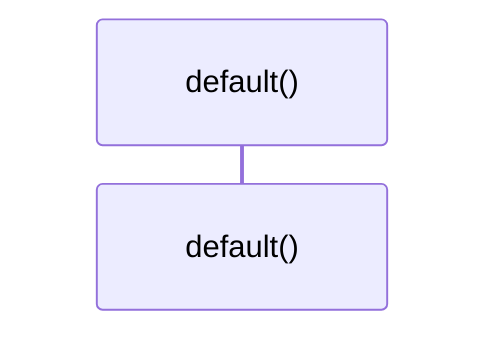

# `robby_render::view::select::impl Default for SelectOpts`

[Self-model](../../../README.md) · [view::select](index.md)

| | |
|---|---|
| kind | `code.impl` |
| location | [`crates/robby-render/src/view/select.rs:47`](../../../../../crates/robby-render/src/view/select.rs#L47) |
| provenance | extractor · confidence 1.00 |

```rust
impl Default for SelectOpts {
    fn default() -> Self {
        Self {
            hierarchy: false,
            hierarchy_depth: 4,
            hierarchy_all: false,
            sibling: false,
            source: true,
            types: true,
            dependencies: true,
            externals: true,
            comments: true,
            links: true,
            entry: true,
            process: true,
        }
    }
}
```

## Referenced by

- calls ← [`robby_render::view::select::collect`](collect.md)
- calls ← [`robby_render::view::select::impl SelectOpts::markdown`](index.md)
- calls ← [`robby_render::view::select::impl SelectOpts::tui_all`](index.md)

### `default`

| | |
|---|---|
| kind | `code.method` |
| signature | `fn default(0)` |
| location | [`crates/robby-render/src/view/select.rs:48`](../../../../../crates/robby-render/src/view/select.rs#L48) |
| provenance | extractor · confidence 1.00 |

```rust
fn default() -> Self {
        Self {
            hierarchy: false,
            hierarchy_depth: 4,
            hierarchy_all: false,
            sibling: false,
            source: true,
            types: true,
            dependencies: true,
            externals: true,
            comments: true,
            links: true,
            entry: true,
            process: true,
        }
    }
```



0 steps · 0 observed · 0 possible only

