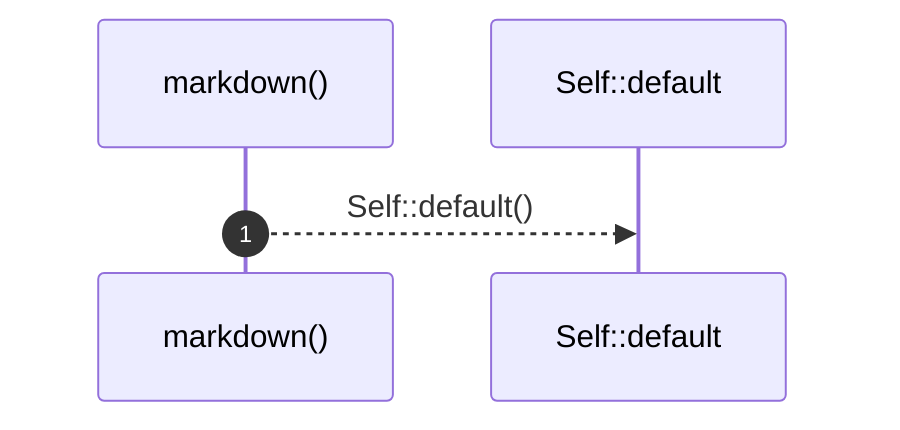
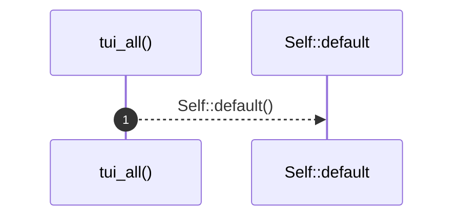

# `robby_render::view::select::impl SelectOpts`

[Self-model](../../../README.md) · [view::select](index.md)

| | |
|---|---|
| kind | `code.impl` |
| location | [`crates/robby-render/src/view/select.rs:66`](../../../../../crates/robby-render/src/view/select.rs#L66) |
| provenance | extractor · confidence 1.00 |

```rust
impl SelectOpts {
    /// Markdown module/item page defaults.
    pub fn markdown() -> Self {
        Self::default()
    }

    /// TUI `show --view all` defaults.
    pub fn tui_all() -> Self {
        Self {
            hierarchy: true,
            ..Self::default()
        }
    }
}
```

## References

- calls → [`robby_render::view::select`](index.md) — default

## Referenced by

- calls ← [`robby_render::test_render::externals_and_comments_sections_render`](../../test_render/externals-and-comments-sections-render.md)

### `markdown`

| | |
|---|---|
| kind | `code.method` |
| signature | `fn markdown(0)` |
| location | [`crates/robby-render/src/view/select.rs:67`](../../../../../crates/robby-render/src/view/select.rs#L67) |
| provenance | extractor · confidence 1.00 |

> Markdown module/item page defaults.

```rust
/// Markdown module/item page defaults.
    pub fn markdown() -> Self {
        Self::default()
    }
```



1 steps · 0 observed · 1 possible only

**Edges**

- calls → [`robby_render::view::select::impl Default for SelectOpts::default`](index.md)

### `tui_all`

| | |
|---|---|
| kind | `code.method` |
| signature | `fn tui_all(0)` |
| location | [`crates/robby-render/src/view/select.rs:72`](../../../../../crates/robby-render/src/view/select.rs#L72) |
| provenance | extractor · confidence 1.00 |

> TUI `show --view all` defaults.

```rust
/// TUI `show --view all` defaults.
    pub fn tui_all() -> Self {
        Self {
            hierarchy: true,
            ..Self::default()
        }
    }
```



1 steps · 0 observed · 1 possible only

**Edges**

- calls → [`robby_render::view::select::impl Default for SelectOpts::default`](index.md)

