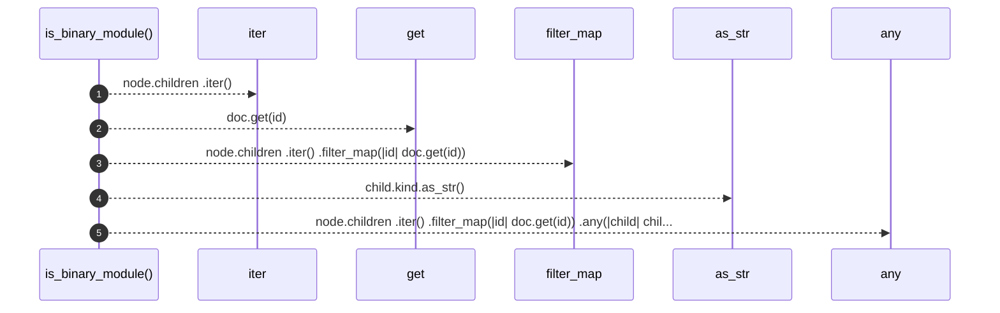

# `robby_render::view::select::is_binary_module`

[Self-model](../../../README.md) · [view::select](index.md)

| | |
|---|---|
| kind | `code.function` |
| signature | `fn is_binary_module(doc: &Document, node: &Node) -> bool` |
| location | [`crates/robby-render/src/view/select.rs:200`](../../../../../crates/robby-render/src/view/select.rs#L200) |
| provenance | extractor · confidence 1.00 |

```rust
pub fn is_binary_module(doc: &Document, node: &Node) -> bool {
    node.children
        .iter()
        .filter_map(|id| doc.get(id))
        .any(|child| child.name == "main" && child.kind.as_str() == kind::code::FUNCTION)
}
```



5 steps · 0 observed · 5 possible only

**Edges**

- calls → [`robby_ir::run::RecipeCatalog::get`](../../../robby_ir/run/index.md)
- calls → [`robby_render::view::comments::impl CommentKind::as_str`](../comments/index.md)

## References

- calls → [`robby_ir::run`](../../../robby_ir/run/index.md) — get
- calls → [`robby_render::view::comments`](../comments/index.md) — as_str

## Referenced by

- calls ← [`robby_render::view::select::collect`](collect.md)

