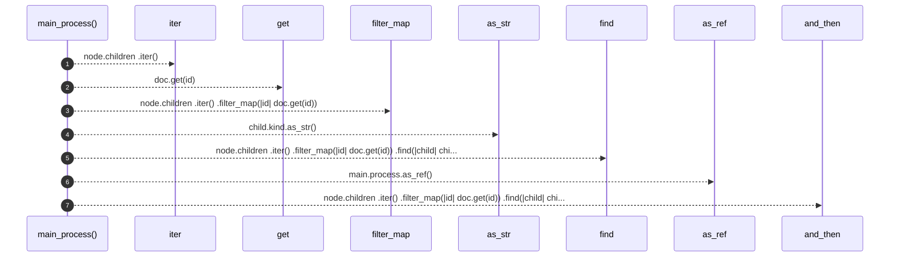

# `robby_render::view::select::main_process`

[Self-model](../../../README.md) · [view::select](index.md)

| | |
|---|---|
| kind | `code.function` |
| signature | `fn main_process<'a>(doc: &'a Document, node: &Node) -> Option<&'a robby_ir::Process>` |
| location | [`crates/robby-render/src/view/select.rs:234`](../../../../../crates/robby-render/src/view/select.rs#L234) |
| provenance | extractor · confidence 1.00 |

```rust
pub fn main_process<'a>(doc: &'a Document, node: &Node) -> Option<&'a robby_ir::Process> {
    node.children
        .iter()
        .filter_map(|id| doc.get(id))
        .find(|child| child.name == "main" && child.kind.as_str() == kind::code::FUNCTION)
        .and_then(|main| main.process.as_ref())
}
```



7 steps · 0 observed · 7 possible only

**Edges**

- calls → [`robby_ir::model::impl Document::get`](../../../robby_ir/model/index.md)
- calls → [`robby_render::view::comments::impl NoteKind::as_str`](../comments/index.md)

## References

- calls → [`robby_ir::model`](../../../robby_ir/model/index.md) — get
- calls → [`robby_render::view::comments`](../comments/index.md) — as_str

## Referenced by

- calls ← [`robby_render::view::select::collect`](collect.md)

