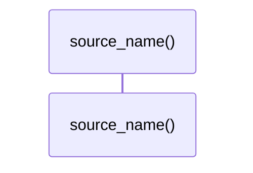

# `robby_render::view::select::source_name`

[Self-model](../../../README.md) · [view::select](index.md)

| | |
|---|---|
| kind | `code.function` |
| signature | `fn source_name(source: Source) -> &'static str` |
| location | [`crates/robby-render/src/view/select.rs:242`](../../../../../crates/robby-render/src/view/select.rs#L242) |
| provenance | extractor · confidence 1.00 |

```rust
fn source_name(source: Source) -> &'static str {
    match source {
        Source::Extractor => "extractor",
        Source::Macro => "macro",
        Source::Trace => "trace",
        Source::Agent => "agent",
        Source::Hand => "hand",
    }
}
```



0 steps · 0 observed · 0 possible only

## Referenced by

- calls ← [`robby_render::view::select::collect`](collect.md)

