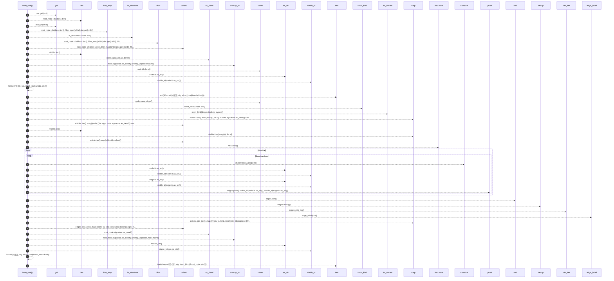
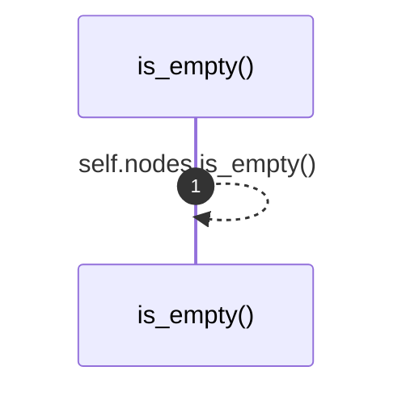

# `robby_render::view::sibling::impl SiblingGraph`

[Self-model](../../../README.md) · [view::sibling](index.md)

| | |
|---|---|
| kind | `code.impl` |
| location | [`crates/robby-render/src/view/sibling.rs:33`](../../../../../crates/robby-render/src/view/sibling.rs#L33) |
| provenance | extractor · confidence 1.00 |

```rust
impl SiblingGraph {
    pub fn from_root(doc: &Document, root: &NodeId) -> Self {
        let Some(root_node) = doc.get(root) else {
            return Self {
                root_id: String::new(),
                root_label: String::new(),
                nodes: Vec::new(),
                edges: Vec::new(),
            };
        };

        let visible: Vec<&Node> = root_node
            .children
            .iter()
            .filter_map(|child| doc.get(child))
            .filter(|node| is_structural(&node.kind))
            .collect();

        let nodes: Vec<SiblingNode> = visible
            .iter()
            .map(|node| {
                let sig = node.signature.as_deref().unwrap_or(&node.name);
                SiblingNode {
                    id: node.id.clone(),
                    stable_id: stable_id(node.id.as_str()),
                    label: text(&format!("{}  [{}]", sig, short_kind(&node.kind))),
                    name: node.name.clone(),
                    kind_tag: short_kind(&node.kind).to_owned(),
                }
            })
            .collect();

        let ids: Vec<&NodeId> = visible.iter().map(|n| &n.id).collect();
        let mut edges: Vec<(String, String, EdgeKind, bool)> = Vec::new();
        for node in &visible {
            for edge in &node.edges {
                if !ids.contains(&&edge.to) {
                    continue;
                }
                edges.push((
                    stable_id(node.id.as_str()),
                    stable_id(edge.to.as_str()),
                    edge.kind,
                    edge.resolved,
                ));
            }
        }
        edges.sort();
        edges.dedup();

        let edges = edges
            .into_iter()
            .map(|(from, to, kind, resolved)| SiblingEdge {
                from,
                to,
                label: edge_label(kind),
                resolved,
                kind,
            })
            .collect();

        let sig = root_node.signature.as_deref().unwrap_or(&root_node.name);
        Self {
            root_id: stable_id(root.as_str()),
            root_label: text(&format!("{}  [{}]", sig, short_kind(&root_node.kind))),
            nodes,
            edges,
        }
    }

    pub fn is_empty(&self) -> bool {
        self.nodes.is_empty()
    }
}
```

## References

- calls → [`robby_ir::run`](../../../robby_ir/run/index.md) — get
- calls → [`robby_render`](../../index.md) — stable_id
- calls → [`robby_render::report`](../../report/index.md) — push
- calls → [`robby_render::util`](../../util/index.md) — edge_label, is_structural, short_kind, text
- calls → [`robby_render::view::comments`](../comments/index.md) — as_str
- calls → [`robby_render::view::scene`](../scene/index.md) — contains, new
- calls → [`robby_render::view::select`](../select/index.md) — collect

### `from_root`

| | |
|---|---|
| kind | `code.method` |
| signature | `fn from_root(2)` |
| location | [`crates/robby-render/src/view/sibling.rs:34`](../../../../../crates/robby-render/src/view/sibling.rs#L34) |
| provenance | extractor · confidence 1.00 |

```rust
pub fn from_root(doc: &Document, root: &NodeId) -> Self {
        let Some(root_node) = doc.get(root) else {
            return Self {
                root_id: String::new(),
                root_label: String::new(),
                nodes: Vec::new(),
                edges: Vec::new(),
            };
        };

        let visible: Vec<&Node> = root_node
            .children
            .iter()
            .filter_map(|child| doc.get(child))
            .filter(|node| is_structural(&node.kind))
            .collect();

        let nodes: Vec<SiblingNode> = visible
            .iter()
            .map(|node| {
                let sig = node.signature.as_deref().unwrap_or(&node.name);
                SiblingNode {
                    id: node.id.clone(),
                    stable_id: stable_id(node.id.as_str()),
                    label: text(&format!("{}  [{}]", sig, short_kind(&node.kind))),
                    name: node.name.clone(),
                    kind_tag: short_kind(&node.kind).to_owned(),
                }
            })
            .collect();

        let ids: Vec<&NodeId> = visible.iter().map(|n| &n.id).collect();
        let mut edges: Vec<(String, String, EdgeKind, bool)> = Vec::new();
        for node in &visible {
            for edge in &node.edges {
                if !ids.contains(&&edge.to) {
                    continue;
                }
                edges.push((
                    stable_id(node.id.as_str()),
                    stable_id(edge.to.as_str()),
                    edge.kind,
                    edge.resolved,
                ));
            }
        }
        edges.sort();
        edges.dedup();

        let edges = edges
            .into_iter()
            .map(|(from, to, kind, resolved)| SiblingEdge {
                from,
                to,
                label: edge_label(kind),
                resolved,
                kind,
            })
            .collect();

        let sig = root_node.signature.as_deref().unwrap_or(&root_node.name);
        Self {
            root_id: stable_id(root.as_str()),
            root_label: text(&format!("{}  [{}]", sig, short_kind(&root_node.kind))),
            nodes,
            edges,
        }
    }
```



42 steps · 0 observed · 42 possible only

**Edges**

- calls → [`robby_ir::run::RecipeCatalog::get`](../../../robby_ir/run/index.md)
- calls → [`robby_ir::run::RecipeCatalog::get`](../../../robby_ir/run/index.md)
- calls → [`robby_render::util::is_structural`](../../util/is-structural.md)
- calls → [`robby_render::view::select::collect`](../select/collect.md)
- calls → [`robby_render::view::comments::impl CommentKind::as_str`](../comments/index.md)
- calls → [`robby_render::stable_id`](../../stable-id.md)
- calls → [`robby_render::util::text`](../../util/text.md)
- calls → [`robby_render::util::short_kind`](../../util/short-kind.md)
- calls → [`robby_render::view::select::collect`](../select/collect.md)
- calls → [`robby_render::view::select::collect`](../select/collect.md)
- calls → [`robby_render::view::scene::impl Rect::new`](../scene/index.md)
- calls → [`robby_render::view::scene::impl WorldRect::contains`](../scene/index.md)
- calls → [`robby_render::view::comments::impl CommentKind::as_str`](../comments/index.md)
- calls → [`robby_render::stable_id`](../../stable-id.md)
- calls → [`robby_render::view::comments::impl CommentKind::as_str`](../comments/index.md)
- calls → [`robby_render::stable_id`](../../stable-id.md)
- calls → [`robby_render::report::impl Report::push`](../../report/index.md)
- calls → [`robby_render::util::edge_label`](../../util/edge-label.md)
- calls → [`robby_render::view::select::collect`](../select/collect.md)
- calls → [`robby_render::view::comments::impl CommentKind::as_str`](../comments/index.md)
- calls → [`robby_render::stable_id`](../../stable-id.md)
- calls → [`robby_render::util::text`](../../util/text.md)

### `is_empty`

| | |
|---|---|
| kind | `code.method` |
| signature | `fn is_empty(1)` |
| location | [`crates/robby-render/src/view/sibling.rs:103`](../../../../../crates/robby-render/src/view/sibling.rs#L103) |
| provenance | extractor · confidence 1.00 |

```rust
pub fn is_empty(&self) -> bool {
        self.nodes.is_empty()
    }
```



1 steps · 0 observed · 1 possible only

**Edges**

- calls → [`robby_render::view::sibling::impl SiblingGraph::is_empty`](index.md)

