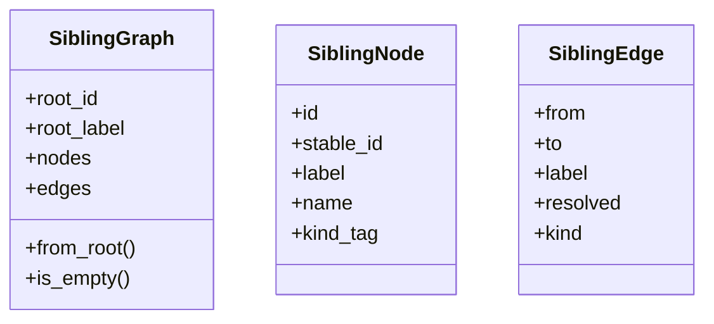
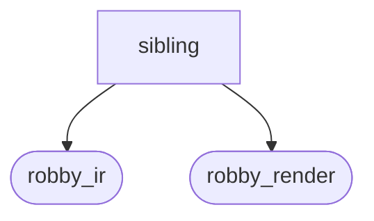
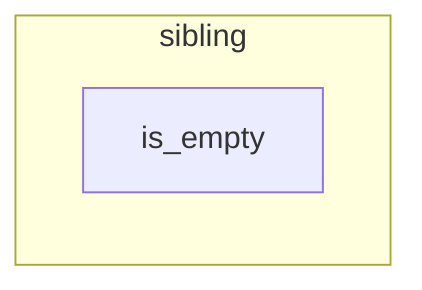

# `robby_render::view::sibling`

[Self-model](../../../README.md) · [view](../index.md)

| | |
|---|---|
| kind | `code.module` |
| declared at | [`crates/robby-render/src/view/mod.rs:16`](../../../../../crates/robby-render/src/view/mod.rs#L16) |
| provenance | extractor · confidence 1.00 |
| nodes | 23 |

## Types

## Package diagram

## Module coupling

## Dependency matrix

| | sibling | robby_ir | robby_render |
|---|---:|---:|---:|
| **sibling** | · | 2 | 20 |
| **robby_ir** | | · | |
| **robby_render** | | | · |
## References

- calls → [`robby_ir::model`](../../../robby_ir/model/index.md) — get
- calls → [`robby_render`](../../index.md) — stable_id
- calls → [`robby_render::report`](../../report/index.md) — push
- calls → [`robby_render::util`](../../util/index.md) — edge_label, is_structural, short_kind, text
- calls → [`robby_render::view::comments`](../comments/index.md) — as_str
- calls → [`robby_render::view::scene`](../scene/index.md) — contains, new
- calls → [`robby_render::view::select`](../select/index.md) — collect

## Items

| Item | Kind | Steps | Location |
|---|---|---:|---|
| [`SiblingGraph`](siblinggraph.md) | `code.struct` | — | `crates/robby-render/src/view/sibling.rs:7:1` |
| [`SiblingNode`](siblingnode.md) | `code.struct` | — | `crates/robby-render/src/view/sibling.rs:15:1` |
| [`SiblingEdge`](siblingedge.md) | `code.struct` | — | `crates/robby-render/src/view/sibling.rs:24:1` |
| [`impl SiblingGraph`](impl-siblinggraph.md) | `code.impl` | — | `crates/robby-render/src/view/sibling.rs:33:1` |

## Imports

- [`use robby_ir::{Document, EdgeKind, Node, NodeId};`](../../../robby_ir/index.md)
- `use crate::util::{edge_label, is_structural, short_kind, stable_id, text};`

