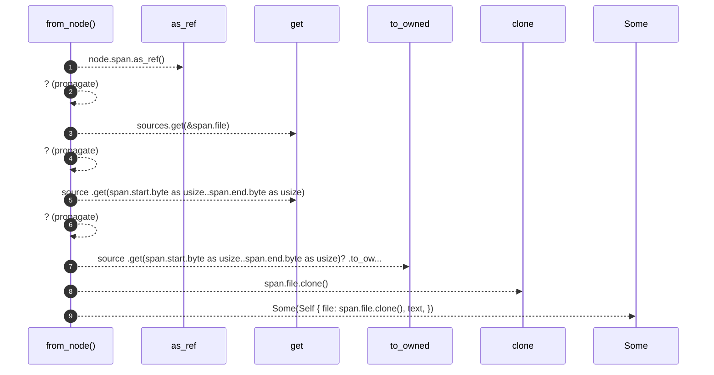

# `robby_render::view::source::impl SourceSlice`

[Self-model](../../../README.md) · [view::source](index.md)

| | |
|---|---|
| kind | `code.impl` |
| location | [`crates/robby-render/src/view/source.rs:13`](../../../../../crates/robby-render/src/view/source.rs#L13) |
| provenance | extractor · confidence 1.00 |

```rust
impl SourceSlice {
    pub fn from_node(node: &Node, sources: &BTreeMap<String, String>) -> Option<Self> {
        let span = node.span.as_ref()?;
        let source = sources.get(&span.file)?;
        let text = source
            .get(span.start.byte as usize..span.end.byte as usize)?
            .to_owned();
        Some(Self {
            file: span.file.clone(),
            text,
        })
    }
}
```

## References

- calls → [`robby_ir::model`](../../../robby_ir/model/index.md) — get

## Referenced by

- calls ← [`robby_render::view::select::collect`](../select/collect.md)

### `from_node`

| | |
|---|---|
| kind | `code.method` |
| signature | `fn from_node(2)` |
| location | [`crates/robby-render/src/view/source.rs:14`](../../../../../crates/robby-render/src/view/source.rs#L14) |
| provenance | extractor · confidence 1.00 |

```rust
pub fn from_node(node: &Node, sources: &BTreeMap<String, String>) -> Option<Self> {
        let span = node.span.as_ref()?;
        let source = sources.get(&span.file)?;
        let text = source
            .get(span.start.byte as usize..span.end.byte as usize)?
            .to_owned();
        Some(Self {
            file: span.file.clone(),
            text,
        })
    }
```



9 steps · 0 observed · 9 possible only

**Edges**

- calls → [`robby_ir::model::impl Document::get`](../../../robby_ir/model/index.md)
- calls → [`robby_ir::model::impl Document::get`](../../../robby_ir/model/index.md)

