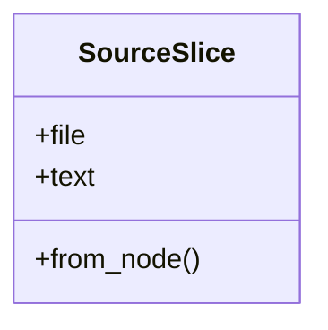
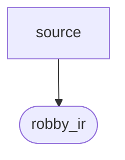

# `robby_render::view::source`

[Self-model](../../../README.md) · [view](../index.md)

| | |
|---|---|
| kind | `code.module` |
| declared at | [`crates/robby-render/src/view/mod.rs:17`](../../../../../crates/robby-render/src/view/mod.rs#L17) |
| provenance | extractor · confidence 1.00 |
| nodes | 9 |

## Types

## Package diagram

## Dependency matrix

| | source | robby_ir |
|---|---:|---:|
| **source** | · | 2 |
| **robby_ir** | | · |
## References

- calls → [`robby_ir::run`](../../../robby_ir/run/index.md) — get

## Referenced by

- calls ← [`robby_render::view::select::collect`](../select/collect.md)

## Items

| Item | Kind | Steps | Location |
|---|---|---:|---|
| [`SourceSlice`](sourceslice.md) | `code.struct` | — | `crates/robby-render/src/view/source.rs:8:1` |
| [`impl SourceSlice`](impl-sourceslice.md) | `code.impl` | — | `crates/robby-render/src/view/source.rs:14:1` |

## Imports

- `use std::collections::BTreeMap;`
- [`use robby_ir::Node;`](../../../robby_ir/index.md)
- `use serde::Serialize;`

