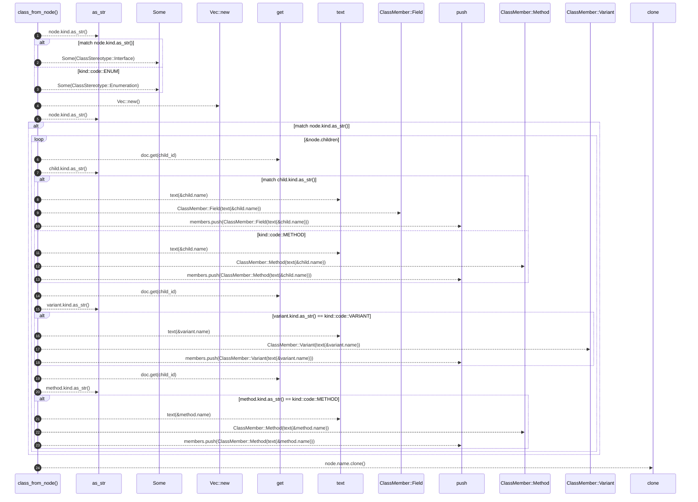

# `robby_render::view::types::class_from_node`

[Self-model](../../../README.md) · [view::types](index.md)

| | |
|---|---|
| kind | `code.function` |
| signature | `fn class_from_node(doc: &Document, node: &Node, id: String) -> ClassView` |
| location | [`crates/robby-render/src/view/types.rs:165`](../../../../../crates/robby-render/src/view/types.rs#L165) |
| provenance | extractor · confidence 1.00 |

```rust
fn class_from_node(doc: &Document, node: &Node, id: String) -> ClassView {
    let stereotype = match node.kind.as_str() {
        kind::code::TRAIT | kind::code::INTERFACE => Some(ClassStereotype::Interface),
        kind::code::ENUM => Some(ClassStereotype::Enumeration),
        _ => None,
    };

    let mut members = Vec::new();
    match node.kind.as_str() {
        kind::code::STRUCT | kind::code::CLASS | kind::code::UNION => {
            for child_id in &node.children {
                let Some(child) = doc.get(child_id) else {
                    continue;
                };
                match child.kind.as_str() {
                    kind::code::FIELD => members.push(ClassMember::Field(text(&child.name))),
                    kind::code::METHOD => members.push(ClassMember::Method(text(&child.name))),
                    _ => {}
                }
            }
        }
        kind::code::ENUM => {
            for child_id in &node.children {
                let Some(variant) = doc.get(child_id) else {
                    continue;
                };
                if variant.kind.as_str() == kind::code::VARIANT {
                    members.push(ClassMember::Variant(text(&variant.name)));
                }
            }
        }
        kind::code::TRAIT | kind::code::INTERFACE => {
            for child_id in &node.children {
                let Some(method) = doc.get(child_id) else {
                    continue;
                };
                if method.kind.as_str() == kind::code::METHOD {
                    members.push(ClassMember::Method(text(&method.name)));
                }
            }
        }
        _ => {}
    }

    ClassView {
        id,
        name: node.name.clone(),
        stereotype,
        members,
    }
}
```



24 steps · 0 observed · 24 possible only

**Edges**

- calls → [`robby_render::view::comments::impl NoteKind::as_str`](../comments/index.md)
- calls → [`robby_render::view::scene::impl Rect::new`](../scene/index.md)
- calls → [`robby_render::view::comments::impl NoteKind::as_str`](../comments/index.md)
- calls → [`robby_ir::model::impl Document::get`](../../../robby_ir/model/index.md)
- calls → [`robby_render::view::comments::impl NoteKind::as_str`](../comments/index.md)
- calls → [`robby_render::util::text`](../../util/text.md)
- calls → [`robby_render::report::impl Report::push`](../../report/index.md)
- calls → [`robby_render::util::text`](../../util/text.md)
- calls → [`robby_render::report::impl Report::push`](../../report/index.md)
- calls → [`robby_ir::model::impl Document::get`](../../../robby_ir/model/index.md)
- calls → [`robby_render::view::comments::impl NoteKind::as_str`](../comments/index.md)
- calls → [`robby_render::util::text`](../../util/text.md)
- calls → [`robby_render::report::impl Report::push`](../../report/index.md)
- calls → [`robby_ir::model::impl Document::get`](../../../robby_ir/model/index.md)
- calls → [`robby_render::view::comments::impl NoteKind::as_str`](../comments/index.md)
- calls → [`robby_render::util::text`](../../util/text.md)
- calls → [`robby_render::report::impl Report::push`](../../report/index.md)

## References

- calls → [`robby_ir::model`](../../../robby_ir/model/index.md) — get
- calls → [`robby_render::report`](../../report/index.md) — push
- calls → [`robby_render::util`](../../util/index.md) — text
- calls → [`robby_render::view::comments`](../comments/index.md) — as_str
- calls → [`robby_render::view::scene`](../scene/index.md) — new

## Referenced by

- calls ← [`robby_render::view::types::impl TypeModel::from_module`](index.md)

