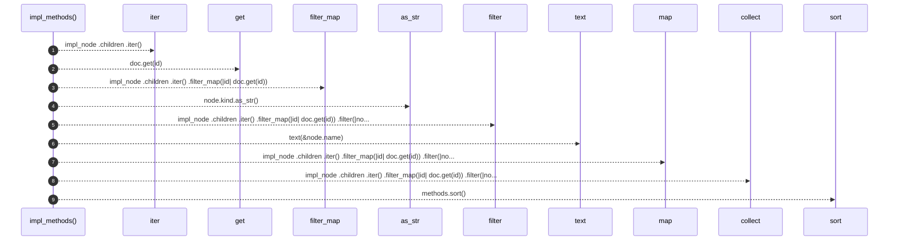

# `robby_render::view::types::impl_methods`

[Self-model](../../../README.md) · [view::types](index.md)

| | |
|---|---|
| kind | `code.function` |
| signature | `fn impl_methods(doc: &Document, impl_node: &Node) -> Vec<String>` |
| location | [`crates/robby-render/src/view/types.rs:218`](../../../../../crates/robby-render/src/view/types.rs#L218) |
| provenance | extractor · confidence 1.00 |

```rust
fn impl_methods(doc: &Document, impl_node: &Node) -> Vec<String> {
    let mut methods: Vec<String> = impl_node
        .children
        .iter()
        .filter_map(|id| doc.get(id))
        .filter(|node| node.kind.as_str() == kind::code::METHOD)
        .map(|node| text(&node.name))
        .collect();
    methods.sort();
    methods
}
```



9 steps · 0 observed · 9 possible only

**Edges**

- calls → [`robby_ir::run::RecipeCatalog::get`](../../../robby_ir/run/index.md)
- calls → [`robby_render::view::comments::impl CommentKind::as_str`](../comments/index.md)
- calls → [`robby_render::util::text`](../../util/text.md)
- calls → [`robby_render::view::select::collect`](../select/collect.md)

## References

- calls → [`robby_ir::run`](../../../robby_ir/run/index.md) — get
- calls → [`robby_render::util`](../../util/index.md) — text
- calls → [`robby_render::view::comments`](../comments/index.md) — as_str
- calls → [`robby_render::view::select`](../select/index.md) — collect

## Referenced by

- calls ← [`robby_render::view::types::impl TypeModel::from_module`](index.md)

