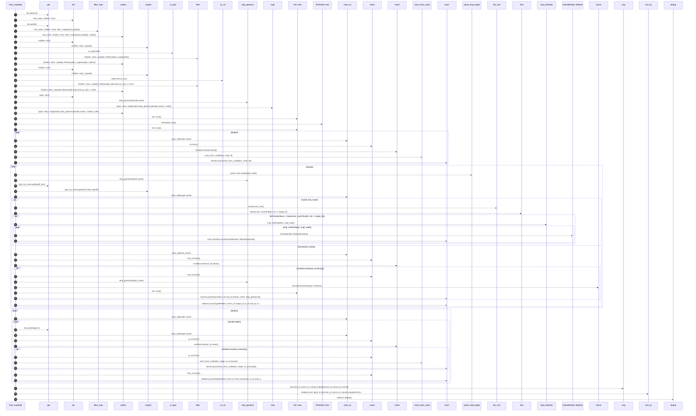
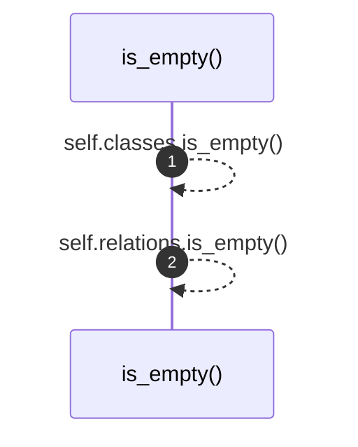

# `robby_render::view::types::impl TypeModel`

[Self-model](../../../README.md) · [view::types](index.md)

| | |
|---|---|
| kind | `code.impl` |
| location | [`crates/robby-render/src/view/types.rs:50`](../../../../../crates/robby-render/src/view/types.rs#L50) |
| provenance | extractor · confidence 1.00 |

```rust
impl TypeModel {
    pub fn from_module(doc: &Document, root: &NodeId) -> Self {
        let Some(root_node) = doc.get(root) else {
            return Self {
                classes: Vec::new(),
                relations: Vec::new(),
            };
        };

        let children: Vec<&Node> = root_node
            .children
            .iter()
            .filter_map(|id| doc.get(id))
            .collect();

        let types: Vec<&Node> = children
            .iter()
            .copied()
            .filter(|node| is_type(node))
            .collect();
        let impls: Vec<&Node> = children
            .iter()
            .copied()
            .filter(|node| node.kind.as_str() == kind::code::IMPL)
            .collect();

        let type_by_name: BTreeMap<String, &Node> = types
            .iter()
            .map(|node| (strip_generics(&node.name), *node))
            .collect();

        let mut classes: Vec<ClassView> = Vec::new();
        let mut emitted: BTreeSet<String> = BTreeSet::new();
        let mut relations: Vec<TypeRelation> = Vec::new();

        for node in &types {
            let id = class_id(&node.name);
            if !emitted.insert(id.clone()) {
                continue;
            }
            classes.push(class_from_node(doc, node, id));
        }

        for impl_node in &impls {
            let Some((trait_name, self_name)) = parse_impl_target(impl_node) else {
                continue;
            };
            let self_key = strip_generics(&self_name);
            let Some(target) = type_by_name.get(&self_key).copied() else {
                continue;
            };
            let target_id = class_id(&target.name);

            match trait_name {
                None => {
                    if let Some(class) = classes.iter_mut().find(|c| c.id == target_id) {
                        for method in impl_methods(doc, impl_node) {
                            class.members.push(ClassMember::Method(method));
                        }
                    }
                }
                Some(trait_name) => {
                    let trait_id = class_id(&trait_name);
                    if emitted.insert(trait_id.clone()) {
                        classes.push(ClassView {
                            id: trait_id.clone(),
                            name: strip_generics(&trait_name),
                            stereotype: Some(ClassStereotype::Interface),
                            members: Vec::new(),
                        });
                    }
                    relations.push(TypeRelation {
                        from_id: target_id,
                        to_id: trait_id,
                        kind: RelationKind::Implements,
                    });
                }
            }
        }

        // Prefer explicit Implements / Extends edges (TypeScript classes, etc.).
        for node in &types {
            let from_id = class_id(&node.name);
            for edge in &node.edges {
                let kind = match edge.kind {
                    EdgeKind::Implements => RelationKind::Implements,
                    EdgeKind::Extends => RelationKind::Extends,
                    _ => continue,
                };
                let Some(target) = doc.get(&edge.to) else {
                    continue;
                };
                let to_id = class_id(&target.name);
                if emitted.insert(to_id.clone()) {
                    classes.push(class_from_node(doc, target, to_id.clone()));
                }
                relations.push(TypeRelation {
                    from_id: from_id.clone(),
                    to_id,
                    kind,
                });
            }
        }

        relations.sort_by(|a, b| (&a.from_id, &a.to_id, a.kind).cmp(&(&b.from_id, &b.to_id, b.kind)));
        relations.dedup();

        Self { classes, relations }
    }

    pub fn is_empty(&self) -> bool {
        self.classes.is_empty() && self.relations.is_empty()
    }
}
```

## References

- calls → [`robby_ir::model`](../../../robby_ir/model/index.md) — get, insert
- calls → [`robby_render::report`](../../report/index.md) — push
- calls → [`robby_render::util`](../../util/index.md) — class_id, is_type, strip_generics
- calls → [`robby_render::view::comments`](../comments/index.md) — as_str
- calls → [`robby_render::view::scene`](../scene/index.md) — new
- calls → [`robby_render::view::select`](../select/index.md) — collect
- calls → [`robby_render::view::types`](index.md) — class_from_node, impl_methods, parse_impl_target

## Referenced by

- calls ← [`robby_render::class_diagram`](../../class-diagram.md)
- calls ← [`robby_render::view::select::collect`](../select/collect.md)

### `from_module`

| | |
|---|---|
| kind | `code.method` |
| signature | `fn from_module(2)` |
| location | [`crates/robby-render/src/view/types.rs:51`](../../../../../crates/robby-render/src/view/types.rs#L51) |
| provenance | extractor · confidence 1.00 |

```rust
pub fn from_module(doc: &Document, root: &NodeId) -> Self {
        let Some(root_node) = doc.get(root) else {
            return Self {
                classes: Vec::new(),
                relations: Vec::new(),
            };
        };

        let children: Vec<&Node> = root_node
            .children
            .iter()
            .filter_map(|id| doc.get(id))
            .collect();

        let types: Vec<&Node> = children
            .iter()
            .copied()
            .filter(|node| is_type(node))
            .collect();
        let impls: Vec<&Node> = children
            .iter()
            .copied()
            .filter(|node| node.kind.as_str() == kind::code::IMPL)
            .collect();

        let type_by_name: BTreeMap<String, &Node> = types
            .iter()
            .map(|node| (strip_generics(&node.name), *node))
            .collect();

        let mut classes: Vec<ClassView> = Vec::new();
        let mut emitted: BTreeSet<String> = BTreeSet::new();
        let mut relations: Vec<TypeRelation> = Vec::new();

        for node in &types {
            let id = class_id(&node.name);
            if !emitted.insert(id.clone()) {
                continue;
            }
            classes.push(class_from_node(doc, node, id));
        }

        for impl_node in &impls {
            let Some((trait_name, self_name)) = parse_impl_target(impl_node) else {
                continue;
            };
            let self_key = strip_generics(&self_name);
            let Some(target) = type_by_name.get(&self_key).copied() else {
                continue;
            };
            let target_id = class_id(&target.name);

            match trait_name {
                None => {
                    if let Some(class) = classes.iter_mut().find(|c| c.id == target_id) {
                        for method in impl_methods(doc, impl_node) {
                            class.members.push(ClassMember::Method(method));
                        }
                    }
                }
                Some(trait_name) => {
                    let trait_id = class_id(&trait_name);
                    if emitted.insert(trait_id.clone()) {
                        classes.push(ClassView {
                            id: trait_id.clone(),
                            name: strip_generics(&trait_name),
                            stereotype: Some(ClassStereotype::Interface),
                            members: Vec::new(),
                        });
                    }
                    relations.push(TypeRelation {
                        from_id: target_id,
                        to_id: trait_id,
                        kind: RelationKind::Implements,
                    });
                }
            }
        }

        // Prefer explicit Implements / Extends edges (TypeScript classes, etc.).
        for node in &types {
            let from_id = class_id(&node.name);
            for edge in &node.edges {
                let kind = match edge.kind {
                    EdgeKind::Implements => RelationKind::Implements,
                    EdgeKind::Extends => RelationKind::Extends,
                    _ => continue,
                };
                let Some(target) = doc.get(&edge.to) else {
                    continue;
                };
                let to_id = class_id(&target.name);
                if emitted.insert(to_id.clone()) {
                    classes.push(class_from_node(doc, target, to_id.clone()));
                }
                relations.push(TypeRelation {
                    from_id: from_id.clone(),
                    to_id,
                    kind,
                });
            }
        }

        relations.sort_by(|a, b| (&a.from_id, &a.to_id, a.kind).cmp(&(&b.from_id, &b.to_id, b.kind)));
        relations.dedup();

        Self { classes, relations }
    }
```



59 steps · 0 observed · 59 possible only

**Edges**

- calls → [`robby_ir::model::impl Document::get`](../../../robby_ir/model/index.md)
- calls → [`robby_ir::model::impl Document::get`](../../../robby_ir/model/index.md)
- calls → [`robby_render::view::select::collect`](../select/collect.md)
- calls → [`robby_render::util::is_type`](../../util/is-type.md)
- calls → [`robby_render::view::select::collect`](../select/collect.md)
- calls → [`robby_render::view::comments::impl NoteKind::as_str`](../comments/index.md)
- calls → [`robby_render::view::select::collect`](../select/collect.md)
- calls → [`robby_render::util::strip_generics`](../../util/strip-generics.md)
- calls → [`robby_render::view::select::collect`](../select/collect.md)
- calls → [`robby_render::view::scene::impl Rect::new`](../scene/index.md)
- calls → [`robby_render::view::scene::impl Rect::new`](../scene/index.md)
- calls → [`robby_render::view::scene::impl Rect::new`](../scene/index.md)
- calls → [`robby_render::util::class_id`](../../util/class-id.md)
- calls → [`robby_ir::model::impl Document::insert`](../../../robby_ir/model/index.md)
- calls → [`robby_render::view::types::class_from_node`](class-from-node.md)
- calls → [`robby_render::report::impl Report::push`](../../report/index.md)
- calls → [`robby_render::view::types::parse_impl_target`](parse-impl-target.md)
- calls → [`robby_render::util::strip_generics`](../../util/strip-generics.md)
- calls → [`robby_ir::model::impl Document::get`](../../../robby_ir/model/index.md)
- calls → [`robby_render::util::class_id`](../../util/class-id.md)
- calls → [`robby_render::view::types::impl_methods`](impl-methods.md)
- calls → [`robby_render::report::impl Report::push`](../../report/index.md)
- calls → [`robby_render::util::class_id`](../../util/class-id.md)
- calls → [`robby_ir::model::impl Document::insert`](../../../robby_ir/model/index.md)
- calls → [`robby_render::util::strip_generics`](../../util/strip-generics.md)
- calls → [`robby_render::view::scene::impl Rect::new`](../scene/index.md)
- calls → [`robby_render::report::impl Report::push`](../../report/index.md)
- calls → [`robby_render::report::impl Report::push`](../../report/index.md)
- calls → [`robby_render::util::class_id`](../../util/class-id.md)
- calls → [`robby_ir::model::impl Document::get`](../../../robby_ir/model/index.md)
- calls → [`robby_render::util::class_id`](../../util/class-id.md)
- calls → [`robby_ir::model::impl Document::insert`](../../../robby_ir/model/index.md)
- calls → [`robby_render::view::types::class_from_node`](class-from-node.md)
- calls → [`robby_render::report::impl Report::push`](../../report/index.md)
- calls → [`robby_render::report::impl Report::push`](../../report/index.md)

### `is_empty`

| | |
|---|---|
| kind | `code.method` |
| signature | `fn is_empty(1)` |
| location | [`crates/robby-render/src/view/types.rs:160`](../../../../../crates/robby-render/src/view/types.rs#L160) |
| provenance | extractor · confidence 1.00 |

```rust
pub fn is_empty(&self) -> bool {
        self.classes.is_empty() && self.relations.is_empty()
    }
```



2 steps · 0 observed · 2 possible only

**Edges**

- calls → [`robby_render::view::types::impl TypeModel::is_empty`](index.md)
- calls → [`robby_render::view::types::impl TypeModel::is_empty`](index.md)

