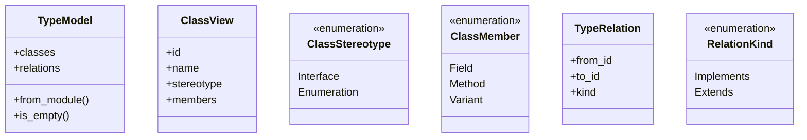
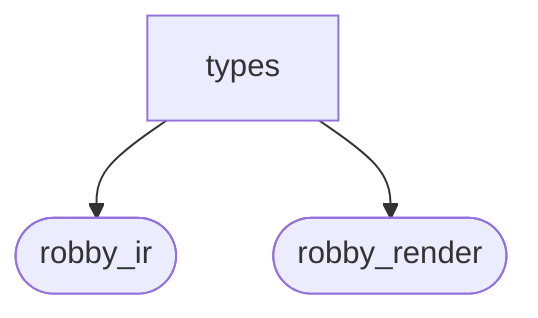
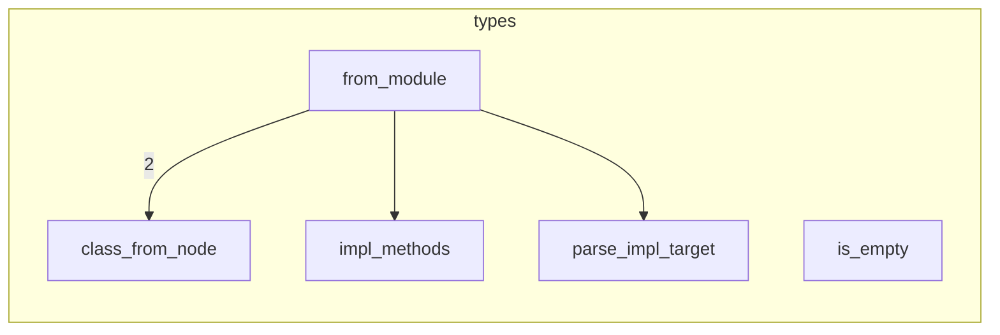

# `robby_render::view::types`

[Self-model](../../../README.md) · [view](../index.md)

| | |
|---|---|
| kind | `code.module` |
| declared at | [`crates/robby-render/src/view/mod.rs:18`](../../../../../crates/robby-render/src/view/mod.rs#L18) |
| provenance | extractor · confidence 1.00 |
| nodes | 32 |

## Types

## Package diagram

## Module coupling

## Dependency matrix

| | types | robby_ir | robby_render |
|---|---:|---:|---:|
| **types** | · | 11 | 41 |
| **robby_ir** | | · | |
| **robby_render** | | | · |
## References

- calls → [`robby_ir::model`](../../../robby_ir/model/index.md) — insert
- calls → [`robby_ir::run`](../../../robby_ir/run/index.md) — get
- calls → [`robby_render::report`](../../report/index.md) — push
- calls → [`robby_render::util`](../../util/index.md) — class_id, is_type, strip_generics, text
- calls → [`robby_render::view::comments`](../comments/index.md) — as_str
- calls → [`robby_render::view::scene`](../scene/index.md) — new
- calls → [`robby_render::view::select`](../select/index.md) — collect

## Referenced by

- calls ← [`robby_render::class_diagram`](../../class-diagram.md)
- calls ← [`robby_render::view::select::collect`](../select/collect.md)

## Items

| Item | Kind | Steps | Location |
|---|---|---:|---|
| [`TypeModel`](typemodel.md) | `code.struct` | — | `crates/robby-render/src/view/types.rs:9:1` |
| [`ClassView`](classview.md) | `code.struct` | — | `crates/robby-render/src/view/types.rs:15:1` |
| [`ClassStereotype`](classstereotype.md) | `code.enum` | — | `crates/robby-render/src/view/types.rs:24:1` |
| [`ClassMember`](classmember.md) | `code.enum` | — | `crates/robby-render/src/view/types.rs:30:1` |
| [`TypeRelation`](typerelation.md) | `code.struct` | — | `crates/robby-render/src/view/types.rs:37:1` |
| [`RelationKind`](relationkind.md) | `code.enum` | — | `crates/robby-render/src/view/types.rs:44:1` |
| [`impl TypeModel`](impl-typemodel.md) | `code.impl` | — | `crates/robby-render/src/view/types.rs:50:1` |
| [`class_from_node`](class-from-node.md) | `code.function` | 24 | `crates/robby-render/src/view/types.rs:166:1` |
| [`impl_methods`](impl-methods.md) | `code.function` | 9 | `crates/robby-render/src/view/types.rs:218:1` |
| [`parse_impl_target`](parse-impl-target.md) | `code.function` | 17 | `crates/robby-render/src/view/types.rs:230:1` |

## Imports

- `use std::collections::{BTreeMap, BTreeSet};`
- [`use robby_ir::{Document, EdgeKind, Node, NodeId, kind};`](../../../robby_ir/index.md)
- `use crate::util::{class_id, is_type, strip_generics, text};`

