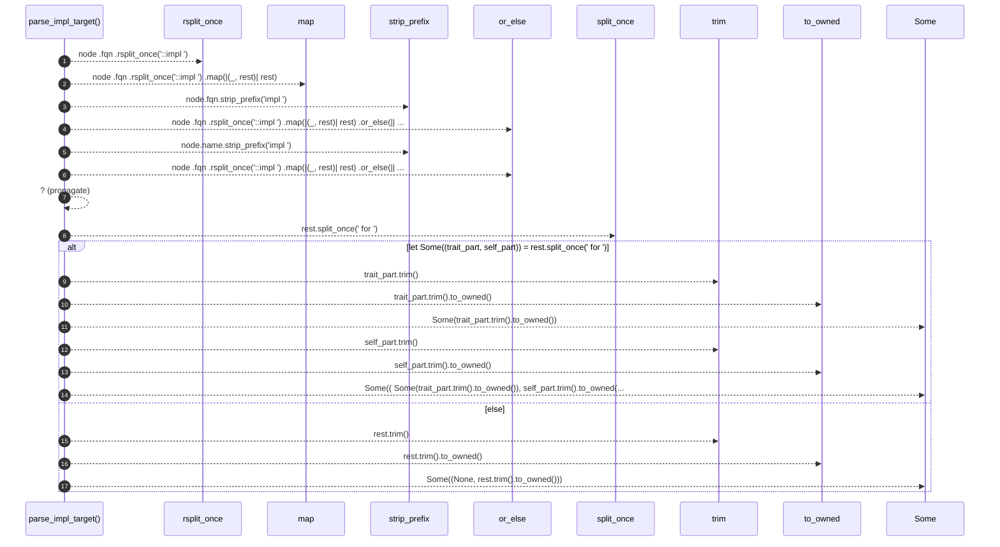

# `robby_render::view::types::parse_impl_target`

[Self-model](../../../README.md) · [view::types](index.md)

| | |
|---|---|
| kind | `code.function` |
| signature | `fn parse_impl_target(node: &Node) -> Option<(Option<String>, String)>` |
| location | [`crates/robby-render/src/view/types.rs:230`](../../../../../crates/robby-render/src/view/types.rs#L230) |
| provenance | extractor · confidence 1.00 |

```rust
fn parse_impl_target(node: &Node) -> Option<(Option<String>, String)> {
    let rest = node
        .fqn
        .rsplit_once("::impl ")
        .map(|(_, rest)| rest)
        .or_else(|| node.fqn.strip_prefix("impl "))
        .or_else(|| node.name.strip_prefix("impl "))?;

    if let Some((trait_part, self_part)) = rest.split_once(" for ") {
        Some((
            Some(trait_part.trim().to_owned()),
            self_part.trim().to_owned(),
        ))
    } else {
        Some((None, rest.trim().to_owned()))
    }
}
```



17 steps · 0 observed · 17 possible only

## Referenced by

- calls ← [`robby_render::view::types::impl TypeModel::from_module`](index.md)

