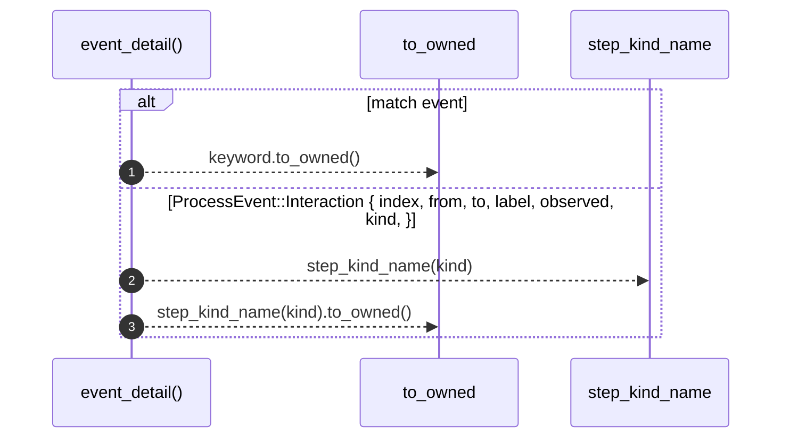

# `robby_render::web::event_detail`

[Self-model](../../README.md) · [web](index.md)

| | |
|---|---|
| kind | `code.function` |
| signature | `fn event_detail(event: ProcessEvent) -> EventDetail` |
| location | [`crates/robby-render/src/web.rs:178`](../../../../crates/robby-render/src/web.rs#L178) |
| provenance | extractor · confidence 1.00 |

```rust
fn event_detail(event: ProcessEvent) -> EventDetail {
    match event {
        ProcessEvent::End => EventDetail::End,
        ProcessEvent::Else { label } => EventDetail::Else { label },
        ProcessEvent::Begin { keyword, label } => EventDetail::Begin {
            keyword: keyword.to_owned(),
            label,
        },
        ProcessEvent::Interaction {
            index,
            from,
            to,
            label,
            observed,
            kind,
        } => EventDetail::Interaction {
            index,
            from,
            to,
            label,
            observed,
            kind: step_kind_name(kind).to_owned(),
        },
    }
}
```



3 steps · 0 observed · 3 possible only

**Edges**

- calls → [`robby_render::web::step_kind_name`](step-kind-name.md)

## References

- calls → [`robby_render::web`](index.md) — step_kind_name

