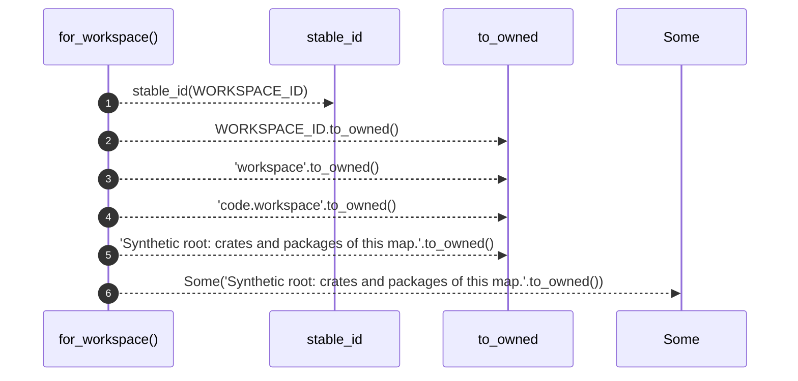
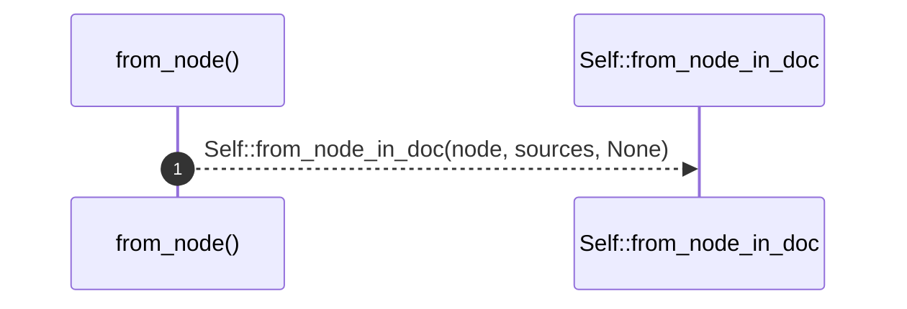
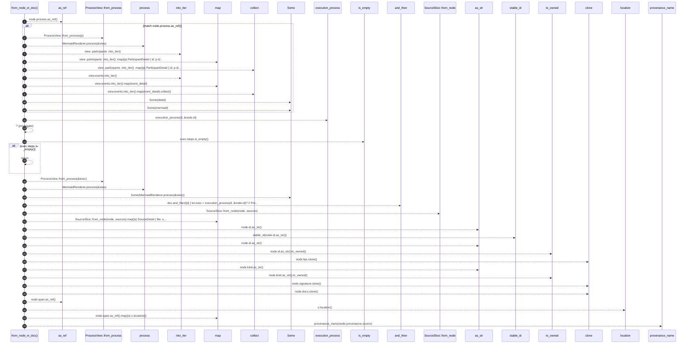
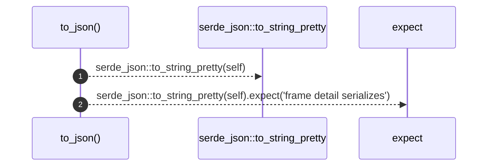

# `robby_render::web::impl FrameDetail`

[Self-model](../../README.md) · [web](index.md)

| | |
|---|---|
| kind | `code.impl` |
| location | [`crates/robby-render/src/web.rs:90`](../../../../crates/robby-render/src/web.rs#L90) |
| provenance | extractor · confidence 1.00 |

```rust
impl FrameDetail {
    pub fn for_workspace() -> Self {
        Self {
            stable_id: stable_id(WORKSPACE_ID),
            id: WORKSPACE_ID.to_owned(),
            fqn: "workspace".to_owned(),
            kind: "code.workspace".to_owned(),
            signature: None,
            docs: Some("Synthetic root: crates and packages of this map.".to_owned()),
            location: None,
            provenance: "extractor",
            confidence: 1.0,
            process: None,
            process_mermaid: None,
            execution_mermaid: None,
            source: None,
        }
    }

    pub fn from_node(node: &Node, sources: &BTreeMap<String, String>) -> Self {
        Self::from_node_in_doc(node, sources, None)
    }

    /// Like [`Self::from_node`], optionally using `doc` for path-level execution.
    pub fn from_node_in_doc(
        node: &Node,
        sources: &BTreeMap<String, String>,
        doc: Option<&Document>,
    ) -> Self {
        let (process, process_mermaid) = match node.process.as_ref() {
            Some(p) => {
                let view = ProcessView::from_process(p);
                let mermaid = MermaidRenderer.process(&view);
                let detail = ProcessDetail {
                    participants: view
                        .participants
                        .into_iter()
                        .map(|p| ParticipantDetail {
                            id: p.id,
                            label: p.label,
                        })
                        .collect(),
                    events: view.events.into_iter().map(event_detail).collect(),
                    step_count: view.step_count,
                    observed_count: view.observed_count,
                };
                (Some(detail), Some(mermaid))
            }
            None => (None, None),
        };

        let execution_mermaid = doc.and_then(|d| {
            let exec = execution_process(d, &node.id)?;
            // Prefer path diagram when it adds call hops beyond the local body.
            if exec.steps.is_empty() {
                return None;
            }
            let view = ProcessView::from_process(&exec);
            Some(MermaidRenderer.process(&view))
        });

        let source = SourceSlice::from_node(node, sources).map(|s| SourceDetail {
            file: s.file,
            text: s.text,
        });

        Self {
            stable_id: stable_id(node.id.as_str()),
            id: node.id.as_str().to_owned(),
            fqn: node.fqn.clone(),
            kind: node.kind.as_str().to_owned(),
            signature: node.signature.clone(),
            docs: node.docs.clone(),
            location: node.span.as_ref().map(|s| s.location()),
            provenance: provenance_name(node.provenance.source),
            confidence: node.provenance.confidence,
            process,
            process_mermaid,
            execution_mermaid,
            source,
        }
    }

    pub fn to_json(&self) -> String {
        serde_json::to_string_pretty(self).expect("frame detail serializes")
    }
}
```

## References

- calls → [`robby_ir::span`](../../robby_ir/span/index.md) — location
- calls → [`robby_render`](../index.md) — stable_id
- calls → [`robby_render::test_render`](../test_render/index.md) — process
- calls → [`robby_render::view::comments`](../view/comments/index.md) — as_str
- calls → [`robby_render::view::execution`](../view/execution/index.md) — execution_process
- calls → [`robby_render::view::links`](../view/links/index.md) — is_empty
- calls → [`robby_render::view::process`](../view/process/index.md) — from_process
- calls → [`robby_render::view::select`](../view/select/index.md) — collect
- calls → [`robby_render::web`](index.md) — provenance_name

## Referenced by

- calls ← [`robby_render::test_web::frame_detail_includes_execution_mermaid_for_call_path`](../test_web/frame-detail-includes-execution-mermaid-for-call-path.md)
- calls ← [`robby_render::test_web::leaf_payload_includes_source_and_process`](../test_web/leaf-payload-includes-source-and-process.md)
- calls ← [`robby_render::tui::tree`](../tui/tree.md)
- calls ← [`robby_render::web::write_site`](write-site.md)

### `for_workspace`

| | |
|---|---|
| kind | `code.method` |
| signature | `fn for_workspace(0)` |
| location | [`crates/robby-render/src/web.rs:91`](../../../../crates/robby-render/src/web.rs#L91) |
| provenance | extractor · confidence 1.00 |

```rust
pub fn for_workspace() -> Self {
        Self {
            stable_id: stable_id(WORKSPACE_ID),
            id: WORKSPACE_ID.to_owned(),
            fqn: "workspace".to_owned(),
            kind: "code.workspace".to_owned(),
            signature: None,
            docs: Some("Synthetic root: crates and packages of this map.".to_owned()),
            location: None,
            provenance: "extractor",
            confidence: 1.0,
            process: None,
            process_mermaid: None,
            execution_mermaid: None,
            source: None,
        }
    }
```



6 steps · 0 observed · 6 possible only

**Edges**

- calls → [`robby_render::stable_id`](../stable-id.md)

### `from_node`

| | |
|---|---|
| kind | `code.method` |
| signature | `fn from_node(2)` |
| location | [`crates/robby-render/src/web.rs:109`](../../../../crates/robby-render/src/web.rs#L109) |
| provenance | extractor · confidence 1.00 |

```rust
pub fn from_node(node: &Node, sources: &BTreeMap<String, String>) -> Self {
        Self::from_node_in_doc(node, sources, None)
    }
```



1 steps · 0 observed · 1 possible only

**Edges**

- calls → [`robby_render::web::impl FrameDetail::from_node_in_doc`](index.md)

### `from_node_in_doc`

| | |
|---|---|
| kind | `code.method` |
| signature | `fn from_node_in_doc(3)` |
| location | [`crates/robby-render/src/web.rs:113`](../../../../crates/robby-render/src/web.rs#L113) |
| provenance | extractor · confidence 1.00 |

> Like [`Self::from_node`], optionally using `doc` for path-level execution.

```rust
/// Like [`Self::from_node`], optionally using `doc` for path-level execution.
    pub fn from_node_in_doc(
        node: &Node,
        sources: &BTreeMap<String, String>,
        doc: Option<&Document>,
    ) -> Self {
        let (process, process_mermaid) = match node.process.as_ref() {
            Some(p) => {
                let view = ProcessView::from_process(p);
                let mermaid = MermaidRenderer.process(&view);
                let detail = ProcessDetail {
                    participants: view
                        .participants
                        .into_iter()
                        .map(|p| ParticipantDetail {
                            id: p.id,
                            label: p.label,
                        })
                        .collect(),
                    events: view.events.into_iter().map(event_detail).collect(),
                    step_count: view.step_count,
                    observed_count: view.observed_count,
                };
                (Some(detail), Some(mermaid))
            }
            None => (None, None),
        };

        let execution_mermaid = doc.and_then(|d| {
            let exec = execution_process(d, &node.id)?;
            // Prefer path diagram when it adds call hops beyond the local body.
            if exec.steps.is_empty() {
                return None;
            }
            let view = ProcessView::from_process(&exec);
            Some(MermaidRenderer.process(&view))
        });

        let source = SourceSlice::from_node(node, sources).map(|s| SourceDetail {
            file: s.file,
            text: s.text,
        });

        Self {
            stable_id: stable_id(node.id.as_str()),
            id: node.id.as_str().to_owned(),
            fqn: node.fqn.clone(),
            kind: node.kind.as_str().to_owned(),
            signature: node.signature.clone(),
            docs: node.docs.clone(),
            location: node.span.as_ref().map(|s| s.location()),
            provenance: provenance_name(node.provenance.source),
            confidence: node.provenance.confidence,
            process,
            process_mermaid,
            execution_mermaid,
            source,
        }
    }
```



34 steps · 0 observed · 34 possible only

**Edges**

- calls → [`robby_render::view::process::impl ProcessView::from_process`](../view/process/index.md)
- calls → [`robby_render::test_render::process`](../test_render/process.md)
- calls → [`robby_render::view::select::collect`](../view/select/collect.md)
- calls → [`robby_render::view::select::collect`](../view/select/collect.md)
- calls → [`robby_render::view::execution::execution_process`](../view/execution/execution-process.md)
- calls → [`robby_render::view::links::impl LinkGraph::is_empty`](../view/links/index.md)
- calls → [`robby_render::view::process::impl ProcessView::from_process`](../view/process/index.md)
- calls → [`robby_render::test_render::process`](../test_render/process.md)
- calls → [`robby_render::web::impl FrameDetail::from_node`](index.md)
- calls → [`robby_render::view::comments::impl NoteKind::as_str`](../view/comments/index.md)
- calls → [`robby_render::stable_id`](../stable-id.md)
- calls → [`robby_render::view::comments::impl NoteKind::as_str`](../view/comments/index.md)
- calls → [`robby_render::view::comments::impl NoteKind::as_str`](../view/comments/index.md)
- calls → [`robby_ir::span::impl Span::location`](../../robby_ir/span/index.md)
- calls → [`robby_render::web::provenance_name`](provenance-name.md)

### `to_json`

| | |
|---|---|
| kind | `code.method` |
| signature | `fn to_json(1)` |
| location | [`crates/robby-render/src/web.rs:173`](../../../../crates/robby-render/src/web.rs#L173) |
| provenance | extractor · confidence 1.00 |

```rust
pub fn to_json(&self) -> String {
        serde_json::to_string_pretty(self).expect("frame detail serializes")
    }
```



2 steps · 0 observed · 2 possible only

