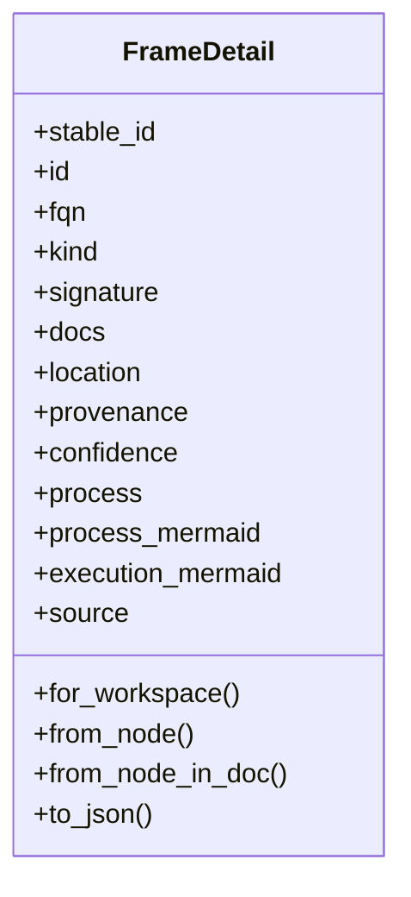
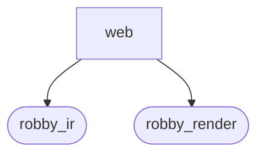
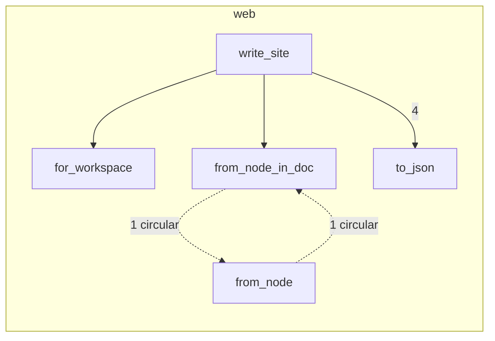

# `robby_render::web`

[Self-model](../../README.md) · [robby_render](../index.md)

| | |
|---|---|
| kind | `code.module` |
| declared at | [`crates/robby-render/src/lib.rs:19`](../../../../crates/robby-render/src/lib.rs#L19) |
| provenance | extractor · confidence 1.00 |
| nodes | 31 |

## Types



## Package diagram



## Module coupling



## Dependency matrix

| | web | robby_ir | robby_render |
|---|---:|---:|---:|
| **web** | · | 4 | 18 |
| **robby_ir** | | · | |
| **robby_render** | | | · |

## Comments

- `crates/robby-render/src/web.rs:120:1` (docs, `robby_render::web::write_site`): "Write scene + frame JSON under `out` (typically `apps/site/public`). Returns the number of frame payload files written.…"
  ```
  /// Write scene + frame JSON under `out` (typically `apps/site/public`).
  ///
  /// Returns the number of frame payload files written. The TypeScript viewer in
  /// `apps/site/src` loads these files; it is not copied here so the self-model
  /// keeps a single source of truth.
  pub fn write_site(doc: &Document, sources: &BTreeMap<String, String>, out: &Path) -> Result<usize> {
      fs::create_dir_all(out)?;
      let frames_dir = out.join("frames");
      fs::create_dir_all(&frames_dir)?;
  
      let structure = Scene::from_document(doc);
      let entrypoints = Scene::from_entrypoints(doc);
      fs::write(out.join("scene.json"), structure.to_json())?;
      fs::write(out.join("scene-entrypoints.json"), entrypoints.to_json())?;
  
      let mut count = 0usize;
  
      let workspace = FrameDetail::for_workspace();
      fs::write(
          frames_dir.join(format!("{}.json", workspace.stable_id)),
          workspace.to_json(),
      )?;
      count += 1;
  
      let mut written: BTreeSet<String> = BTreeSet::new();
      written.insert(workspace.stable_id.clone());
  
      for scene in [&structure, &entrypoints] {
          for frame in scene.frames.values() {
              if frame.id == WORKSPACE_ID {
                  continue;
              }
              if !written.insert(frame.stable_id.clone()) {
                  continue;
              }
              let Some(node) = doc.get(&robby_ir::NodeId::from(frame.id.as_str())) else {
                  continue;
              };
              let detail = FrameDetail::from_node_in_doc(node, sources, Some(doc));
              fs::write(
                  frames_dir.join(format!("{}.json", detail.stable_id)),
                  detail.to_json(),
              )?;
              count += 1;
          }
      }
  
      // Stamp for `robby web --watch` / viewer poll: changes when the site is rewritten.
      let rebuilt_at = std::time::SystemTime::now()
          .duration_since(std::time::UNIX_EPOCH)
          .map(|d| d.as_millis() as u64)
          .unwrap_or(0);
      let build = serde_json::json!({
          "rebuilt_at": rebuilt_at,
          "frames": count,
          "nodes": doc.nodes.len(),
          "files": doc.files.len(),
          "generator": doc.generator,
      });
      fs::write(out.join("build.json"), serde_json::to_string_pretty(&build)?)?;
  
      // Completed pipeline history for Runs mode (synthetic extract + this web build).
      crate::runs::write_site_runs(doc, out, count, rebuilt_at)?;
  
      Ok(count)
  }
  ```
- `crates/robby-render/src/web.rs:21:1` (docs, `robby_render::web::FrameDetail`): "Lazy detail for one frame (fetched after the camera settles)."
  ```
  /// Lazy detail for one frame (fetched after the camera settles).
  #[derive(Debug, Clone, PartialEq, Serialize)]
  pub struct FrameDetail {
      pub stable_id: String,
      pub id: String,
      pub fqn: String,
      pub kind: String,
      #[serde(skip_serializing_if = "Option::is_none")]
      pub signature: Option<String>,
      #[serde(skip_serializing_if = "Option::is_none")]
      pub docs: Option<String>,
      #[serde(skip_serializing_if = "Option::is_none")]
      pub location: Option<String>,
      pub provenance: &'static str,
      pub confidence: f32,
      #[serde(skip_serializing_if = "Option::is_none")]
      pub process: Option<ProcessView>,
      /// Mermaid `sequenceDiagram` body for the process (same path as Markdown).
      #[serde(skip_serializing_if = "Option::is_none")]
      pub process_mermaid: Option<String>,
      /// Path-level execution sequence (Calls + owning types for methods).
      #[serde(skip_serializing_if = "Option::is_none")]
      pub execution_mermaid: Option<String>,
      #[serde(skip_serializing_if = "Option::is_none")]
      pub source: Option<SourceSlice>,
  }
  ```
- `crates/robby-render/src/web.rs:71:5` (docs, `robby_render::web::impl FrameDetail::from_node_in_doc`): "Like [`Self::from_node`], optionally using `doc` for path-level execution."
  ```
  /// Like [`Self::from_node`], optionally using `doc` for path-level execution.
      pub fn from_node_in_doc(
          node: &Node,
          sources: &BTreeMap<String, String>,
          doc: Option<&Document>,
      ) -> Self {
          let (process, process_mermaid) = match node.process.as_ref() {
              Some(p) => {
                  let view = ProcessView::from_process(p);
                  let mermaid = MermaidRenderer.process(&view);
                  (Some(view), Some(mermaid))
              }
              None => (None, None),
          };
  
          let execution_mermaid = doc.and_then(|d| {
              let exec = execution_process(d, &node.id)?;
              // Prefer path diagram when it adds call hops beyond the local body.
              if exec.steps.is_empty() {
                  return None;
              }
              let view = ProcessView::from_process(&exec);
              Some(MermaidRenderer.process(&view))
          });
  
          let source = SourceSlice::from_node(node, sources);
  
          Self {
              stable_id: stable_id(node.id.as_str()),
              id: node.id.as_str().to_owned(),
              fqn: node.fqn.clone(),
              kind: node.kind.as_str().to_owned(),
              signature: node.signature.clone(),
              docs: node.docs.clone(),
              location: node.span.as_ref().map(robby_ir::Span::location),
              provenance: node.provenance.source.as_str(),
              confidence: node.provenance.confidence,
              process,
              process_mermaid,
              execution_mermaid,
              source,
          }
      }
  ```
## References

- calls → [`robby_ir::kind`](../../robby_ir/kind/index.md) — from
- calls → [`robby_ir::model`](../../robby_ir/model/index.md) — insert
- calls → [`robby_ir::run`](../../robby_ir/run/index.md) — get
- calls → [`robby_render`](../index.md) — stable_id
- calls → [`robby_render::pipeline`](../pipeline/index.md) — from_document
- calls → [`robby_render::report`](../report/index.md) — new
- calls → [`robby_render::runs`](../runs/index.md) — write_site_runs
- calls → [`robby_render::test_render`](../test_render/index.md) — process
- calls → [`robby_render::view::comments`](../view/comments/index.md) — as_str
- calls → [`robby_render::view::execution`](../view/execution/index.md) — execution_process
- calls → [`robby_render::view::links`](../view/links/index.md) — is_empty
- calls → [`robby_render::view::process`](../view/process/index.md) — from_process
- calls → [`robby_render::view::scene`](../view/scene/index.md) — from_entrypoints

## Referenced by

- calls ← [`robby_cli::write_web`](../../robby_cli/write-web.md)
- calls ← [`robby_render::test_web::frame_detail_includes_execution_mermaid_for_call_path`](../test_web/frame-detail-includes-execution-mermaid-for-call-path.md)
- calls ← [`robby_render::test_web::leaf_payload_includes_source_and_process`](../test_web/leaf-payload-includes-source-and-process.md)
- calls ← [`robby_render::test_web::write_site_emits_run_records`](../test_web/write-site-emits-run-records.md)
- calls ← [`robby_render::test_web::write_site_emits_scene_and_frames`](../test_web/write-site-emits-scene-and-frames.md)
- calls ← [`robby_render::tui::tree`](../tui/tree.md)

## Items

| Item | Kind | Steps | Location |
|---|---|---:|---|
| [`FrameDetail`](framedetail.md) | `code.struct` | — | `crates/robby-render/src/web.rs:21:1` |
| [`impl FrameDetail`](impl-framedetail.md) | `code.impl` | — | `crates/robby-render/src/web.rs:48:1` |
| [`write_site`](write-site.md) | `code.function` | 51 | `crates/robby-render/src/web.rs:120:1` |

## Imports

- `use std::collections::{BTreeMap, BTreeSet};`
- `use std::fs;`
- `use std::path::Path;`
- `use anyhow::Result;`
- `use serde::Serialize;`
- [`use robby_ir::{Document, Node, Source};`](../../robby_ir/index.md)
- `use crate::render::MermaidRenderer;`
- `use crate::render::Renderer;`
- `use crate::util::stable_id;`
- `use crate::view::{ProcessView, Scene, SourceSlice, WORKSPACE_ID, execution_process};`

