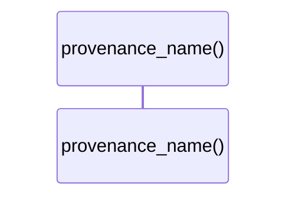

# `robby_render::web::provenance_name`

[Self-model](../../README.md) · [web](index.md)

| | |
|---|---|
| kind | `code.function` |
| signature | `fn provenance_name(source: Source) -> &'static str` |
| location | [`crates/robby-render/src/web.rs:214`](../../../../crates/robby-render/src/web.rs#L214) |
| provenance | extractor · confidence 1.00 |

```rust
fn provenance_name(source: Source) -> &'static str {
    match source {
        Source::Extractor => "extractor",
        Source::Macro => "macro",
        Source::Trace => "trace",
        Source::Agent => "agent",
        Source::Hand => "hand",
    }
}
```



0 steps · 0 observed · 0 possible only

## Referenced by

- calls ← [`robby_render::web::impl FrameDetail::from_node_in_doc`](index.md)

