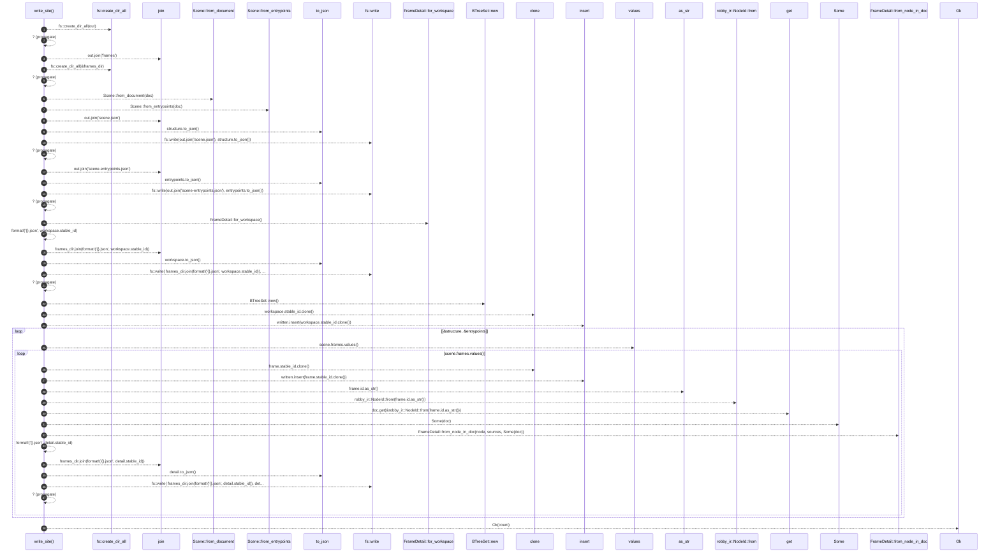

# `robby_render::web::write_site`

[Self-model](../../README.md) · [web](index.md)

| | |
|---|---|
| kind | `code.function` |
| signature | `fn write_site(     doc: &Document,     sources: &BTreeMap<String, String>,     out: &Path, ) -> Result<usize>` |
| location | [`crates/robby-render/src/web.rs:224`](../../../../crates/robby-render/src/web.rs#L224) |
| provenance | extractor · confidence 1.00 |

> Write scene + frame JSON under `out` (typically `apps/site/public`).
> 
> Returns the number of frame payload files written. The TypeScript viewer in
> `apps/site/src` loads these files; it is not copied here so the self-model
> keeps a single source of truth.

```rust
/// Write scene + frame JSON under `out` (typically `apps/site/public`).
///
/// Returns the number of frame payload files written. The TypeScript viewer in
/// `apps/site/src` loads these files; it is not copied here so the self-model
/// keeps a single source of truth.
pub fn write_site(
    doc: &Document,
    sources: &BTreeMap<String, String>,
    out: &Path,
) -> Result<usize> {
    fs::create_dir_all(out)?;
    let frames_dir = out.join("frames");
    fs::create_dir_all(&frames_dir)?;

    let structure = Scene::from_document(doc);
    let entrypoints = Scene::from_entrypoints(doc);
    fs::write(out.join("scene.json"), structure.to_json())?;
    fs::write(out.join("scene-entrypoints.json"), entrypoints.to_json())?;

    let mut count = 0usize;

    let workspace = FrameDetail::for_workspace();
    fs::write(
        frames_dir.join(format!("{}.json", workspace.stable_id)),
        workspace.to_json(),
    )?;
    count += 1;

    let mut written: BTreeSet<String> = BTreeSet::new();
    written.insert(workspace.stable_id.clone());

    for scene in [&structure, &entrypoints] {
        for frame in scene.frames.values() {
            if frame.id == WORKSPACE_ID {
                continue;
            }
            if !written.insert(frame.stable_id.clone()) {
                continue;
            }
            let Some(node) = doc.get(&robby_ir::NodeId::from(frame.id.as_str())) else {
                continue;
            };
            let detail = FrameDetail::from_node_in_doc(node, sources, Some(doc));
            fs::write(
                frames_dir.join(format!("{}.json", detail.stable_id)),
                detail.to_json(),
            )?;
            count += 1;
        }
    }

    Ok(count)
}
```



38 steps · 0 observed · 38 possible only

**Edges**

- calls → [`robby_render::pipeline::from_document`](../pipeline/from-document.md)
- calls → [`robby_render::view::scene::impl Scene::from_entrypoints`](../view/scene/index.md)
- calls → [`robby_render::web::impl FrameDetail::to_json`](index.md)
- calls → [`robby_render::web::impl FrameDetail::to_json`](index.md)
- calls → [`robby_render::web::impl FrameDetail::for_workspace`](index.md)
- calls → [`robby_render::web::impl FrameDetail::to_json`](index.md)
- calls → [`robby_render::report::impl Report::new`](../report/index.md)
- calls → [`robby_ir::model::impl Document::insert`](../../robby_ir/model/index.md)
- calls → [`robby_ir::model::impl Document::insert`](../../robby_ir/model/index.md)
- calls → [`robby_render::view::comments::impl NoteKind::as_str`](../view/comments/index.md)
- calls → [`robby_ir::kind::impl From<&str> for Kind::from`](../../robby_ir/kind/index.md)
- calls → [`robby_ir::model::impl Document::get`](../../robby_ir/model/index.md)
- calls → [`robby_render::web::impl FrameDetail::from_node_in_doc`](index.md)
- calls → [`robby_render::web::impl FrameDetail::to_json`](index.md)

## References

- calls → [`robby_ir::kind`](../../robby_ir/kind/index.md) — from
- calls → [`robby_ir::model`](../../robby_ir/model/index.md) — get, insert
- calls → [`robby_render::pipeline`](../pipeline/index.md) — from_document
- calls → [`robby_render::report`](../report/index.md) — new
- calls → [`robby_render::view::comments`](../view/comments/index.md) — as_str
- calls → [`robby_render::view::scene`](../view/scene/index.md) — from_entrypoints
- calls → [`robby_render::web`](index.md) — for_workspace, from_node_in_doc, to_json

## Referenced by

- calls ← [`robby_cli::web`](../../robby_cli/web.md)
- calls ← [`robby_render::test_web::write_site_emits_scene_and_frames`](../test_web/write-site-emits-scene-and-frames.md)

