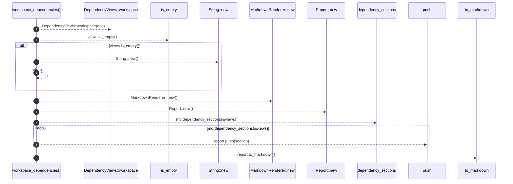

# `robby_render::workspace_dependencies`

[Self-model](../README.md) · [robby_render](index.md)

| | |
|---|---|
| kind | `code.function` |
| signature | `fn workspace_dependencies(doc: &Document) -> String` |
| location | [`crates/robby-render/src/lib.rs:85`](../../../crates/robby-render/src/lib.rs#L85) |
| provenance | extractor · confidence 1.00 |

> Workspace-wide dependency formalisms (crates).

```rust
/// Workspace-wide dependency formalisms (crates).
pub fn workspace_dependencies(doc: &Document) -> String {
    let views = DependencyViews::workspace(doc);
    if views.is_empty() {
        return String::new();
    }
    let md = MarkdownRenderer::new();
    let mut report = Report::new();
    for section in md.dependency_sections(&views) {
        report.push(section);
    }
    report.to_markdown()
}
```



9 steps · 0 observed · 9 possible only

**Edges**

- calls → [`robby_render::test_tree::workspace`](test_tree/workspace.md)
- calls → [`robby_render::view::links::impl LinkGraph::is_empty`](view/links/index.md)
- calls → [`robby_render::report::impl Report::new`](report/index.md)
- calls → [`robby_render::report::impl Report::new`](report/index.md)
- calls → [`robby_render::report::impl Report::new`](report/index.md)
- calls → [`robby_render::render::Renderer::dependency_sections`](render/index.md)
- calls → [`robby_render::report::impl Report::push`](report/index.md)
- calls → [`robby_render::report::impl Report::to_markdown`](report/index.md)

## References

- calls → [`robby_render::render`](render/index.md) — dependency_sections
- calls → [`robby_render::report`](report/index.md) — new, push, to_markdown
- calls → [`robby_render::test_tree`](test_tree/index.md) — workspace
- calls → [`robby_render::view::links`](view/links/index.md) — is_empty

## Referenced by

- calls ← [`robby_render::test_render::dependencies_emits_package_weighted_and_dsm`](test_render/dependencies-emits-package-weighted-and-dsm.md)
- calls ← [`robby_render::tree::global_index`](tree/global-index.md)

